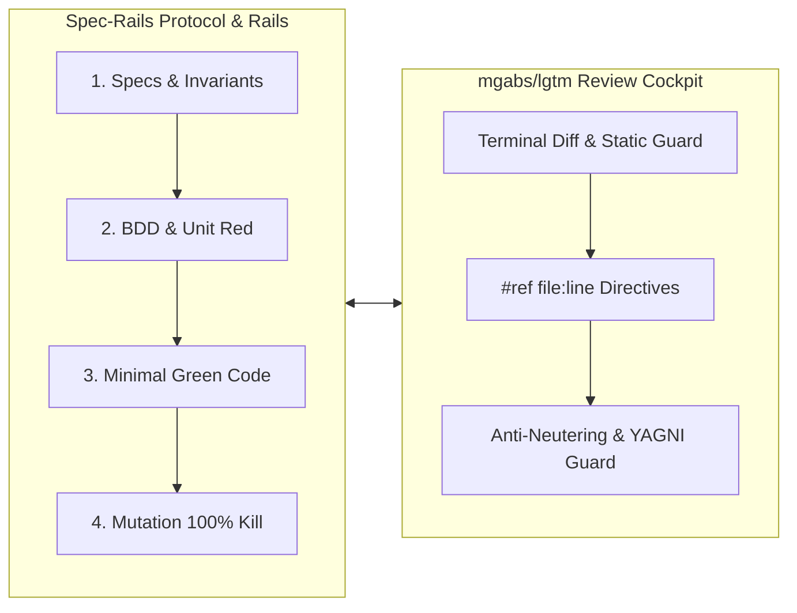

# Spec-Rails — Spec-Driven, Testing-Railed Development

Distributable, language-agnostic development workflow combining **Spec-Driven** human review gates, **Multi-Agent Git Worktree** parallelism, **BDD + Red-Green-Mutation Testing Rails**, and **Zero-Contamination Bug Isolation**.

Paired with [mgabs/lgtm](https://github.com/mgabs/lgtm) as the real-time code review cockpit and agent steering harness.

---

## Methodology & Logic

Spec-Rails solves the core failure modes of autonomous and pair-programming AI development: **hallucinated scope**, **stale architectural documentation**, **tautological/untested code**, and **branch pollution**.



### 1. Spec-Driven, Not Prompt-Driven (The Ponytail Mindset & Strict YAGNI)
- AI agents easily over-engineer or misinterpret informal prompts.
- Spec-Rails applies the **Ponytail Mindset**: strictly adhere to YAGNI (You Aren't Gonna Need It), eliminating speculative abstractions and unsolicited features.
- Structured **Human Gates** enforce boundaries before code is written:
  - **Gate 1 (Proposal)**: Pinpoints intent, measurable success metrics, and strict Out-of-Scope (YAGNI) boundaries.
  - **Gate 2 (Specs)**: Formalizes uniquely keyed requirements (`REQ-*`, `NFR-*`) and Given/When/Then scenarios.
  - **Gate 3 (Design)**: Enforces domain boundaries (Pure Core vs. I/O Shell) and latency/allocation budgets.
  - **Gate 4 (Tasks DAG)**: Maps dependencies and partitions orthogonal tasks into parallel worktree streams.

### 2. Testing Rails: BDD, Red-Green, 100% Mutation Kill
- Tests are not written after the fact as documentation. They are rails that guide the code.
- **Red-First**: Unit tests must fail before production code is written.
- **Mutation Verification**: Coverage numbers ($\ge 95\%$) can be gamed with tautological assertions. Spec-Rails requires **100% mutation kill score** on domain logic. Any mutant that survives flips the status to blocking failure: either an assertion is missing, or dead code was written and must be deleted.

### 3. Zero-Contamination Git Worktree Isolation
- `main` is always shippable and pristine.
- Vertical slices execute in disposable Git worktrees (`.worktrees/`).
- Bugfixes use the **Fast-Track Protocol** (Gates B1–B3): isolated in `.worktrees/fix-<slug>` off `main`, verified with a failing Red test before code changes, and merged via `--ff-only`.

### 4. Harness Pairing: [mgabs/lgtm](https://github.com/mgabs/lgtm)
Spec-Rails pairs natively with [mgabs/lgtm](https://github.com/mgabs/lgtm), a keyboard-driven terminal diff reviewer and AI agent steering TUI:
- **Line-Anchored Directives (`#ref file:line <directive>`)**: Human reviewers navigate streaming diffs using Vim keybindings and inject actionable steering chords (`ca` coverage, `cs` security, `cr` refactor) directly into active agent panes.
- **Anti-Fraud & Test Neutering Guardrails**: `lgtm`'s static analysis automatically blocks test neutering (deleted assertions, skipped tests, mock inflation, self-assertions) and dead function addition (YAGNI violations).
- **Native MCP Agent Mode**: Coding agents query diffs, security audits, and review directives programmatically via `lgtm serve --mcp`.

---

## Repository Layout

```text
spec-rails/
├── bin/
│   └── spec-rails                 # Initialization script (`spec-rails [target-repo]`)
├── docs/
│   ├── WAY_OF_WORKING.md     # Detailed Way of Working (WoW) engineering handbook
│   ├── WIKI.md               # Architectural wiki, gate matrix & testing rails
│   └── how-tos/
│       ├── 01-bootstrap-new-project.md
│       ├── 02-drive-feature-lifecycle.md
│       ├── 03-parallel-worktrees-multi-agent.md
│       ├── 04-fast-track-bugfix.md
│       └── 05-configure-ai-agents.md
├── specs/
│   └── WORKFLOW.md           # Canonical stack-agnostic Spec-Rails workflow specification
├── templates/
│   ├── research.md           # Gate 0: Research & Tradeoffs template
│   ├── proposal.md           # Gate 1: Feature Proposal template
│   ├── spec.md               # Gate 2: Capability Specification template
│   ├── design.md             # Gate 3: Architecture & Design template
│   ├── tasks.md              # Gate 4: DAG & Worktree Stream Tasks template
│   ├── bug-report.md         # Gate B1: Fast-Track Bug Report template
│   └── .pre-commit-config.yaml
├── rules/
│   └── AGENTS.md             # Always-on agent guardrails
├── skills/
│   └── spec-rails/
│       └── SKILL.md          # Agent skill runbook
├── tests/
│   ├── test_installer.sh     # Installer tests (bin/spec-rails)
│   ├── test_check.sh         # Gate/lane check tests (bin/spec-rails-check)
│   └── test_schema.sh        # spec-rails schema tests
├── Makefile                  # Test runner (`make test`)
└── plugin.json               # Agent plugin manifest
```

---

## Quick Start

### Install on an OpenSpec Project
Prerequisites: an existing `openspec init` project, OpenSpec ≥ 1.15.0 on `PATH`, and `jq` (for `spec-rails-check`).
```bash
/path/to/spec-rails/bin/spec-rails [init] [target-repo]
```

Copies the `spec-rails` schema to `openspec/schemas/spec-rails/`, sets `schema: spec-rails` in `openspec/config.yaml` (other keys preserved), installs the branch-protection hook, CI workflow, mutation templates, and agent rules (`openspec/spec-rails/`, which `openspec update` does not regenerate), keeps any existing `.pre-commit-config.yaml`, and ignores `.worktrees/`. Re-running is a no-op. Spec requirements use `### Requirement: REQ-<DOMAIN>-<N> <name>` headers in OpenSpec delta specs. Gate and lane check: `bin/spec-rails-check`. See `specs/WORKFLOW.md` §7.

### Documentation & Guides

- **Engineering Roadmap**: [docs/ROADMAP.md](docs/ROADMAP.md)
- **Architecture & Methodology Wiki**: [docs/WIKI.md](docs/WIKI.md)
- **Review Harness & Agent Steering**: [github.com/mgabs/lgtm](https://github.com/mgabs/lgtm)
- **How-To 1**: [Bootstrap a New Project](docs/how-tos/01-bootstrap-new-project.md)
- **How-To 2**: [Drive Feature Lifecycle (Gates 1–6)](docs/how-tos/02-drive-feature-lifecycle.md)
- **How-To 3**: [Parallel Worktrees & Multi-Agent Streams](docs/how-tos/03-parallel-worktrees-multi-agent.md)
- **How-To 4**: [Fast-Track Bugfix Protocol](docs/how-tos/04-fast-track-bugfix.md)
- **How-To 5**: [Configure AI Agents](docs/how-tos/05-configure-ai-agents.md)

### Running Tests
```bash
make test
```
