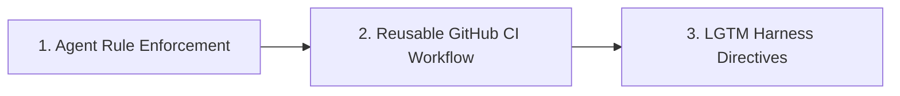

# Spec-Rails Roadmap: OpenSpec Addon Rails

Spec-Rails follows strict YAGNI: an OpenSpec schema plus a thin POSIX-sh installer (`bin/spec-rails`) and check (`bin/spec-rails-check`).
Validation and archival use `openspec`, standard Git, agent rules, and CI. Delivery status lives in `specs/ROADMAP.md`.

---



---

## 1. Agent-Enforced Verification

The AI coding agent validates gate artifacts; `spec-rails-check` enforces gates and lanes mechanically.

- **Gate Validation**: Before presenting a gate for human sign-off, agent verifies:
  - Gate 1: `proposal.md` has Intent, Problem, In-Scope, Out-of-Scope (YAGNI), Assumptions.
  - Gate 2: `spec.md` has uniquely keyed `REQ-*`, `NFR-*`, and Given/When/Then scenarios.
  - Gate 3: `design.md` has boundary rules (Pure Core vs I/O Shell) and performance budgets.
  - Gate 4: `tasks.md` has DAG and multi-agent stream worktrees identified.
- **Gate 6 Spec Sync & Archival**: When a feature completes, agent runs:
  ```bash
  openspec validate <feat>
  openspec archive <feat> --yes
  ```

---

## 2. Reusable GitHub CI Workflow (`templates/spec-rails-ci.yml`)

A GitHub Actions workflow installed to `.github/workflows/spec-rails-ci.yml`:

1. **Spec-to-Code Audit**:
   - Uses `git diff --name-only origin/main...HEAD`
   - If production code is modified, fails unless `openspec/changes/` or `specs/bug-reports/` is also modified.
2. **Pre-Commit Linting**:
   - Runs `pre-commit run --all-files`.
3. **Testing & Mutation Rails**:
   - Runs project test suite (`make test` or stack runner).
   - Enforces coverage ($\ge 95\%$) and $100\%$ mutation kill score on modified modules.

---

## 3. LGTM Harness Directives & Review Pairing

- Reviewer uses [mgabs/lgtm](https://github.com/mgabs/lgtm) TUI to navigate diffs.
- Reviewer sends `#ref file:line <directive>` chords (`ca` coverage, `cs` security, `cr` refactor).
- Agent resolves feedback before requesting gate approval.
