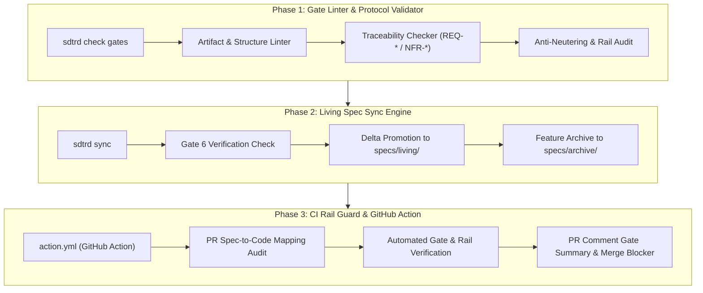

# SDTRD Engineering Roadmap: Automation Suite

This roadmap defines the automated tooling for SDTRD to eliminate manual review friction, prevent stale specifications, and block unverified code in CI.

---



---

## 1. Feature 1: Gate Linter & Protocol Validator (`sdtrd check`)

### Problem
Human reviewers and lead developers must manually inspect markdown files to verify that feature proposals contain required sections, requirements are uniquely keyed, edge cases and NFR budgets are defined, and testing rails are met.

### Target Architecture
A zero-dependency CLI command (`sdtrd check [gates|rails|feature]`) that validates repository compliance against [specs/WORKFLOW.md](../specs/WORKFLOW.md).

### Capabilities & Specifications

#### 1.1 Gate Artifact Structural Validation (`sdtrd check gates`)
- **Gate 1 (`proposal.md`)**:
  - Validates presence of: `## Intent`, `## Problem Statement`, `## Scope` (with explicit `In-Scope` and `Out-of-Scope (YAGNI)`), `## Assumptions`, and `## Success Metrics`.
  - Flags missing or empty sections.
- **Gate 2 (`specs/<capability>/spec.md`)**:
  - Validates requirement key format: `REQ-<DOMAIN>-<ID>` and `NFR-<DOMAIN>-<ID>`.
  - Validates presence of Given / When / Then behavioral scenarios.
  - Flags unkeyed requirements or missing boundary/error cases.
- **Gate 3 (`design.md`)**:
  - Validates presence of: Architectural Overview & Invariants, Domain Models, Boundary Rules (Pure Core vs. I/O Shell), and Performance/Latency Budgets matching `NFR-*`.
- **Gate 4 (`tasks.md`)**:
  - Validates task DAG: identifies prerequisites, stream assignments (`.worktrees/<id>-<stream>`), and ensures test-first order (BDD $\rightarrow$ Unit Red $\rightarrow$ Code Green $\rightarrow$ Mutation).
- **Gate B1–B3 (`bug-reports/<date>-<slug>.md`)**:
  - Validates bug triage report format, root cause analysis, reproduction steps, and verifies dedicated worktree isolation (`.worktrees/fix-<slug>`).

#### 1.2 Testing Rails Verification (`sdtrd check rails`)
- Verifies `.pre-commit-config.yaml` is present and active.
- Executes project linter and unit tests.
- Checks coverage threshold ($\ge 95\%$ line & branch).
- Audits for anti-fraud invariants (flags deleted assertions, skipped tests, vacuous mocks).

---

## 2. Feature 2: Living Spec Sync Engine (`sdtrd sync`)

### Problem
At Gate 6, feature delta specs in `specs/features/<feature>/specs/` must be promoted into the canonical `specs/living/` ground truth. When done manually, developers forget to copy files, leaving `specs/living/` stale and divergent from production code.

### Target Architecture
An automated promotion and archiving command:

```bash
sdtrd sync <feature-id>
```

### Capabilities & Specifications

#### 2.1 Gate 6 Pre-Flight Check
Before syncing, `sdtrd sync` verifies:
- All tasks in `specs/features/<feature>/tasks.md` are marked complete (`[x]`).
- Full test suite passes.
- Line & branch coverage $\ge 95\%$.
- Mutation kill score is $100\%$ on core logic.
- All parallel stream worktrees (`.worktrees/<feature>-*`) have been merged and pruned.

#### 2.2 Canonical Promotion & Collision Detection
- Promotes `specs/features/<feature>/specs/<capability>/spec.md` $\rightarrow$ `specs/living/<capability>/spec.md`.
- Automatically indexes requirement keys (`REQ-*`, `NFR-*`) across all living specs to guarantee global uniqueness.
- Flags superseded requirements and updates requirement history logs.

#### 2.3 Feature Archival
- Moves completed feature directory:
  `specs/features/<feature>/` $\rightarrow$ `specs/archive/<feature>/`
- Appends completion metadata: completion timestamp, final merge commit hash, and sign-off status.

---

## 3. Feature 3: CI Rail Guard & GitHub Action (`sdtrd-action`)

### Problem
PRs on GitHub can be merged without human reviewers noticing that a feature proposal was never written, gate checklists were bypassed, or coverage slipped below the 95% rail.

### Target Architecture
A reusable GitHub Action (`action.yml`) that can be dropped into any repository's `.github/workflows/ci.yml`:

```yaml
- name: Verify SDTRD Gates & Rails
  uses: mgabs/sdtrd@main
  with:
    enforce_specs: true
    min_coverage: 95
    mutation_score: 100
```

### Capabilities & Specifications

#### 3.1 Spec-to-Code Mapping Audit
- Inspects changed files in the PR diff:
  - If production code (`src/**`, `crates/**`, `lib/**`) is touched, PR MUST include either:
    1. An active feature specification under `specs/features/`, OR
    2. An active bugfix report under `specs/bug-reports/`.
  - PRs touching production code without spec/report updates are failed immediately.

#### 3.2 Automated Rail & Gate Validation
- Runs `sdtrd check gates` on active feature/bug specs.
- Verifies pre-commit formatting and linter checks.
- Runs project test suite and verifies coverage $\ge 95\%$.
- Executes mutation test runner and confirms 100% kill score on modified modules.

#### 3.3 PR Comment Gate Summary & Status Check
- Posts an automated markdown table to the PR thread summarizing gate status:
  - Gate 1 (Proposal): Approved / Missing
  - Gate 2 (Specs): Traceable (`REQ-*` count)
  - Gate 3 (Design): Validated
  - Gate 4 (Tasks): All items checked
  - Test Rails: Pass ($\ge 95\%$ coverage, $100\%$ mutation kill score)
- Sets GitHub commit status to `success` or `failure`, blocking merge until green.

---

## 4. Implementation Phasing & Next Steps

| Phase | Milestone | Deliverables | Status |
| :--- | :--- | :--- | :--- |
| **Phase 0** | Protocol & Baseline | `specs/WORKFLOW.md`, `templates/`, `bin/sdtrd`, `docs/WIKI.md`, unit tests | **Done** (Commit `a1eb8b9`) |
| **Phase 1** | Gate Linter | `sdtrd check` implementation, markdown AST linter, requirement validator, unit tests | **Next** |
| **Phase 2** | Living Spec Sync | `sdtrd sync`, living spec promoter, collision indexer, archiver, unit tests | Queued |
| **Phase 3** | CI Action | `action.yml`, GitHub Action entrypoint, PR diff auditor, PR comment reporter | Queued |
| **Phase 4** | LGTM Bridge | Direct `.lgtm/reviews/` & MCP directive ingestion into agent task lists | Queued |
