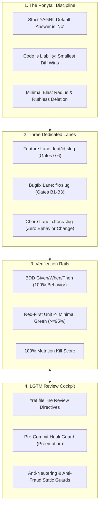
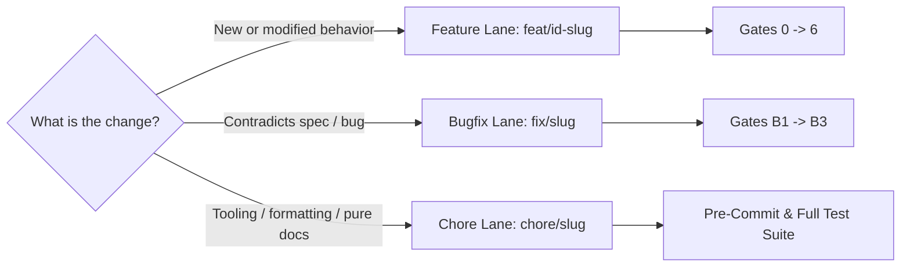
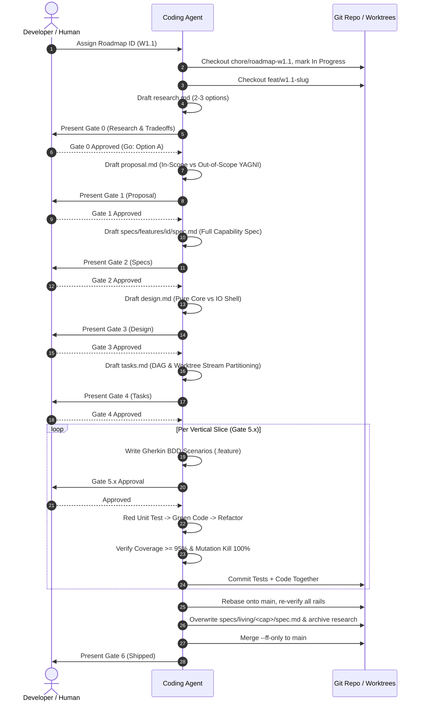
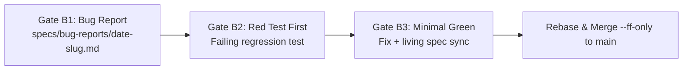

# SDTRD Way of Working (WoW)

> **Spec-Driven, Testing-Railed Development** — An engineering handbook for humans and autonomous AI agents.

---

## 1. Executive Summary & Core Invariants

SDTRD transforms AI-assisted software delivery from speculative, prompt-driven chaos into a deterministic, gated assembly line. It guarantees four engineering invariants:

1. **`main` is strictly immutable to direct edits**: Zero code, specs, or docs land directly on `main`. Every commit lands through an isolated lane via `--ff-only`.
2. **Code is a liability, not an asset**: The smallest diff that satisfies formal requirements and passes all rails wins.
3. **No untested code exists**: Code does not exist until a test fails for its absence. Coverage ($\ge 95\%$) is insufficient without a **100% mutation kill score**.
4. **Specs are evergreen living truth**: Specifications are full capability models, never partial deltas. They sync into `specs/living/` upon shipping.



---

## 2. The Mindset: Ponytail Discipline & Strict YAGNI

SDTRD adopts the **Ponytail Mindset** — the pragmatic, ruthless discipline of senior unix hackers who hate unnecessary code and refuse to be paged at 3 AM:

- **Default Answer is "No"**: Push back on speculative, vague, or unneeded requirements before typing code. Challenge requirements during Gate 0 and Gate 1.
- **Boring > Clever**: Choose standard library functions over third-party dependencies. Choose simple iterative loops over complex metaprogramming acrobatics.
- **Strict YAGNI**: Build strictly what the active vertical slice requires. Never add hypothetical abstractions, premature plugin interfaces, or speculative configuration toggles.
- **Minimal Blast Radius**: Touch only files strictly necessary for the active task. Do not reformat unrelated files or rename adjacent symbols.
- **Ruthless Deletion**: Deleting code is superior to adding code. When mutation testing discovers surviving mutants in defensive or unneeded branches, delete the dead code immediately.

---

## 3. The Three Development Lanes

Every unit of work travels down exactly one lane. Identify the lane before touching a single file.



### 3.1 Feature Lane (`feat/<id>-<slug>`)
- **Use when**: Adding new functionality, modifying existing user-visible behavior, or refactoring architectural boundaries that impact specifications.
- **Lifecycle**: Gates 0 through 6 (§4).
- **Branch naming**: `feat/<id>-<slug>` (e.g., `feat/w1.1-token-contracts`).
- **Target**: Merged into `main` via `--ff-only` upon completing Gate 6.

### 3.2 Bugfix Lane (`fix/<slug>`)
- **Use when**: Merged production behavior violates written specifications, documentation, or user intent.
- **Lifecycle**: Fast-Track Gates B1 through B3 (§5).
- **Branch naming**: `fix/<slug>` in disposable worktree `.worktrees/fix-<slug>` off `main`.
- **Target**: Merged into `main` via `--ff-only`.

### 3.3 Chore Lane (`chore/<slug>`)
- **Use when**: Zero behavior change — documentation updates, formatting, dependency updates, CI/workflow adjustments, and refactors that leave every existing test unchanged.
- **Lifecycle**: No gates required. Must pass pre-commit hooks, linters, and the full test suite.
- **Branch naming**: `chore/<slug>` (e.g., `chore/way-of-working-doc`, `chore/roadmap-w1.1`).
- **Rule**: If a chore turns out to alter runtime behavior, stop immediately and restart in the Feature or Bugfix lane.

---

## 4. The Feature Lifecycle Playbook (Gates 0 to 6)

Every feature follows 7 human-in-the-loop gates. Agents **never** self-approve or skip gates. A gate is passed only when its markdown artifact is signed off by a human reviewer.



### Gate 0: Research & Tradeoffs
- **Artifact**: `specs/features/<id>-<slug>/research.md`
- **Goal**: Investigate 2–3 viable technical options, verify ground truth in code/docs, identify breaking changes, and recommend an approach before writing code.
- **Decision**:
  - **Go**: Update `specs/ROADMAP.md` to `🚀 In Progress` via chore lane; proceed to Gate 1.
  - **No-Go**: Commit `research.md` to `specs/archive/<id>-<slug>/`, mark `❌ Dropped` in roadmap with rationale via chore lane, and delete the feature branch.

### Gate 1: Proposal & YAGNI Boundaries
- **Artifact**: `specs/features/<id>-<slug>/proposal.md`
- **Goal**: Lock down the problem, user stories, quantifiable success metrics, and strict **Out-of-Scope (YAGNI)** boundaries.
- **Rule**: Out-of-Scope items in `proposal.md` are binding prohibitions for the remainder of the feature.

### Gate 2: Full Capability Specifications
- **Artifact**: `specs/features/<id>-<slug>/specs/<capability>/spec.md`
- **Goal**: Formalize behavioral requirements (`REQ-*`), non-functional requirements (`NFR-*`), and Given/When/Then scenarios.
- **Rule**: **Full copy, never deltas**. If modifying an existing capability, copy `specs/living/<capability>/spec.md` into the feature directory and edit it in full. Gate 6 will overwrite living specs in one atomic step.

### Gate 3: Architecture & Design
- **Artifact**: `specs/features/<id>-<slug>/design.md`
- **Goal**: Define domain boundaries (Pure Core vs. I/O Shell), data structures, memory/latency budgets, and error recovery contracts.
- **Rule**: Core domain logic must have zero dependencies on I/O, network, or frameworks.

### Gate 4: Tasks DAG & Stream Partitioning
- **Artifact**: `specs/features/<id>-<slug>/tasks.md`
- **Goal**: Decompose design into an ordered Directed Acyclic Graph (DAG) of vertical slices.
- **Rule**: Group independent tasks into parallel worktree streams (e.g., Stream A: Core Parser, Stream B: Serializer). Dependent tasks execute sequentially.

### Gate 5.x: Vertical Slice Apply Loop
Each slice `x` runs three non-negotiable steps:
1. **5.x-A (BDD Scenarios)**: Write Gherkin `.feature` tests covering all `REQ-*` invariants. Stop for human Gate 5.x review.
2. **5.x-B (Red-Green-Refactor)**: Write failing unit test (`Red`) verified locally, implement minimal code (`Green`), refactor under green protection. **Red tests are never committed alone**; commit tests + code together. Line & branch coverage must be $\ge 95\%$.
3. **5.x-C (100% Mutation Kill)**: Run mutation analysis on the slice. Every surviving mutant is a blocking defect resolved by targeted assertions, dead code deletion, or equivalent-mutant restructuring.

### Gate 6: Living Spec Sync, Archive & Merge
1. Ensure all stream worktrees are merged, removed, and pruned (`git worktree prune`).
2. Rebase feature branch onto `main` and re-run all test and mutation rails.
3. Sync full capability spec to `specs/living/<capability>/spec.md` (safe overwrite).
4. Move research and planning artifacts to `specs/archive/<id>-<slug>/`.
5. Merge feature branch into `main` via `git merge --ff-only`.
6. Mark item `✅ Shipped` in `specs/ROADMAP.md` via chore lane.

---

## 5. The Fast-Track Bugfix Protocol (Gates B1 to B3)

When a defect is discovered in production, do not spawn a feature lifecycle. Use the 3-gate Fast-Track protocol:



1. **Gate B1 (Bug Report & Reproduction)**:
   - Create isolated worktree: `git worktree add .worktrees/fix-<slug> -b fix/<slug> main`.
   - Copy `templates/bug-report.md` to `specs/bug-reports/<YYYY-MM-DD>-<slug>.md`.
   - Fill in actual behavior, expected behavior, root cause hypothesis, and affected `REQ-*`. Stop for human sign-off.
2. **Gate B2 (Red Regression Test First)**:
   - Write a unit or integration regression test that reproduces the defect.
   - Run the test suite against unmodified production code and demonstrate the test failing.
   - Do not commit the red test alone.
3. **Gate B3 (Green Fix, Spec Sync & Cleanup)**:
   - Implement the minimal fix to turn the test green (Ponytail discipline).
   - If the bug altered capability requirements, update the corresponding `specs/living/<capability>/spec.md`.
   - Commit regression test + fix + living spec together in a single atomic commit.
   - Rebase onto `main`, merge `--ff-only`.
   - Remove worktree: `git worktree remove .worktrees/fix-<slug>`, delete branch `git branch -d fix/<slug>`, and run `git worktree prune`.

---

## 6. Multi-Agent Git Worktree Parallelism

When Gate 4 identifies orthogonal streams, execute them in parallel Git worktrees without repository contamination:

```text
sdtrd/                           <-- Root worktree (main or feat/<id>)
├── .worktrees/
│   ├── w1.1-stream-a/           <-- Isolated worktree for Stream A (feat/w1.1/a)
│   └── w1.1-stream-b/           <-- Isolated worktree for Stream B (feat/w1.1/b)
```

### Worktree Invariants
- **Contract Lock First**: Shared types, interfaces, and contracts must be committed to the feature branch *before* worktrees are spawned. Streams code against locked contracts.
- **Ignored Directory**: `.worktrees/` must always be listed in `.gitignore`.
- **Zero Config Mutation**: Worktree operations must never mutate shared repository config.
- **Subagent Gate Escalation**: Subagents working in worktrees **never** self-approve gates. When a slice is ready for review, the subagent halts and escalates to the orchestrating agent to obtain human approval.
- **Sequential Integration**:
  - Stream 1 merges into the feature branch `--ff-only`.
  - Stream 2 rebases onto the updated feature branch, re-runs its test and mutation rails, and merges `--ff-only`.
  - Immediately remove worktree and prune:
    ```bash
    git worktree remove .worktrees/<id>-<stream>
    git branch -d feat/<id>/<stream>
    git worktree prune
    ```

---

## 7. The Review Cockpit: [mgabs/lgtm](https://github.com/mgabs/lgtm) Steering & Preemption

SDTRD pairs natively with `mgabs/lgtm` for real-time diff review and agent steering.

### Directive Preemption Protocol
Reviewers inject line-anchored chords into diffs:
```text
#ref path/to/file.rs:42 [ca] Add edge case test for empty byte slice
#ref path/to/service.py:88 [cs] Unsanitized parameter passed to shell
#ref path/to/module.ts:15 [cr] Delete unused helper function (YAGNI)
```
- **Preemption Rule**: When active directives exist in `.lgtm/reviews/` or chat, **all task execution halts**. The agent resolves directives, verifies tests, and clears the review file before resuming forward progress.
- **Pre-Commit Enforcement**: The pre-commit hook automatically halts `git commit` if any `#ref` directives remain in `.lgtm/reviews/`.

### Anti-Fraud & Test Neutering Guardrails
`lgtm` static guards reject pull requests and commits that attempt to cheat testing rails:
- **Test Neutering**: Deleting assertions, weakening bounds, commenting out tests, or adding `.skip` / `@Ignore` annotations.
- **Vacuous Mocks**: Assertions that assert mock returns against themselves (`assert mock.call() == mock.call()`).
- **Dead Code Additions**: Adding functions or methods with zero call-sites across the codebase.

---

## 8. Verification Rails & Pre-Commit Standards

Every repository initialized with `sdtrd` contains active pre-commit and CI verification rails:

### Pre-Commit Standards
- Pre-commit hooks run automatically on every `git commit`.
- **Zero-Bypass Policy**: `git commit --no-verify` or `-n` is strictly forbidden. If a check fails, resolve the defect.

### Mutation Testing Rails
- **100% Mutation Kill Score** on domain logic, zero exemptions.
- Reference configurations in `templates/mutation/`:
  - **Rust**: [templates/mutation/cargo-mutants.toml](file:///Users/mmetawea/Workbench/sdtrd/templates/mutation/cargo-mutants.toml)
  - **JS / TS**: [templates/mutation/stryker.config.json](file:///Users/mmetawea/Workbench/sdtrd/templates/mutation/stryker.config.json)
  - **Python**: [templates/mutation/mutmut.ini](file:///Users/mmetawea/Workbench/sdtrd/templates/mutation/mutmut.ini)

---

## 9. Communication Standards (Caveman Style)

When pair-programming or coordinating agents:
- **Caveman Communication**: Short, blunt, extremely direct. Absolute fewest words possible.
- **No Fluff**: No pleasantries, no apologies, no conversational filler, no narration of internal steps.
- **Clickable Links**: Always link referenced files using GitHub-style markdown links (`[file.ext](file:///abs/path)`).

---

## 10. Anti-Patterns & Hard Prohibitions

| Violation | Why It Is Forbidden | Remedy |
| :--- | :--- | :--- |
| **Direct commit on `main`** | Contaminates production, bypasses rebase verification | Enforced by pre-commit hook; checkout dedicated lane branch |
| **Committing Red tests alone** | Leaves broken commits in git history, breaks bisecting | Commit Red test together with Green implementation |
| **Partial delta spec** | Creates drift and fragmented ground truth | Full copy of capability spec; atomic overwrite at Gate 6 |
| **Surviving mutant excuses** | Surviving mutants prove missing assertions or dead code | Kill mutant with test, delete dead code, or restructure |
| **Subagent gate self-approval** | Eliminates human-in-the-loop safety | Halt and escalate to orchestrating agent for human sign-off |
| **Stale worktrees lingering** | Causes `.git/index.lock` collisions and disk bloat | Run `git worktree remove` and `git worktree prune` after every merge |
| **Unsolicited architecture** | Violates YAGNI, inflates maintenance cost | Build only what is specified; delete speculative code |
