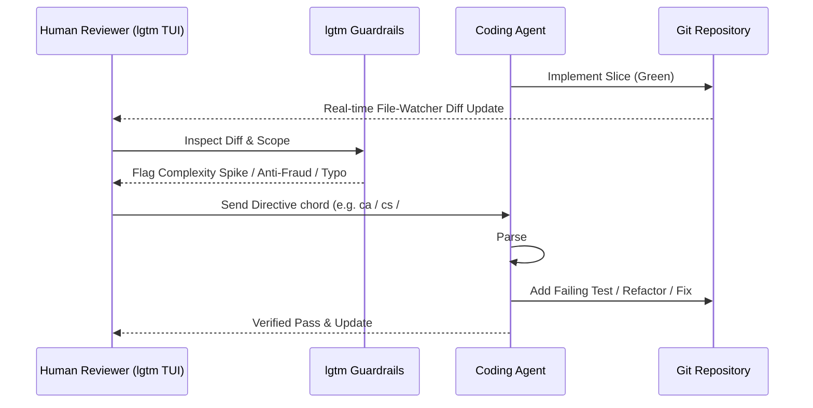

# Spec-Rails Wiki: Spec-Driven, Testing-Railed Development

Spec-Rails (Spec-Driven, Testing-Railed Development) is an engineering and AI-agent orchestration framework designed to eliminate hallucinated scope, stale documentation, untested regressions, and branch contamination in autonomous and pair-programming development.

For the comprehensive operational handbook, see [WAY_OF_WORKING.md](WAY_OF_WORKING.md).

---

## 1. Core Principles

### 1.1 The Ponytail Discipline (Strict YAGNI)
- **Zero Unsolicited Architecture**: Build strictly what the active capability requires. Never introduce hypothetical abstractions, premature plugin frameworks, or configurable toggles before a concrete requirement demands them.
- **Minimal Blast Radius**: Code changes must touch only the files strictly necessary to satisfy the active vertical slice.

### 1.2 Zero-Contamination Isolation
- Production branches (`main` / `master`) are immutable to direct edits; everything lands via `--ff-only` after rebase + re-verification.
- Three lanes: features (`feat/<id>-<slug>`, Gates 0–6), bugfixes (`fix/<slug>`, Gates B1–B3), chores (`chore/<slug>`, zero behavior change, no gates).
- Concurrent subagent execution occurs in dedicated Git worktrees (`.worktrees/<id>-<stream>`).
- Bugfixes occur in dedicated bugfix worktrees (`.worktrees/fix-<slug>`) branching directly off the base branch, preventing feature-branch bleed into hotfixes.

### 1.3 Testing Rails (Red-First & 100% Mutation Kill)
- Code does not exist until a test fails for its absence.
- Red tests are verified locally, never committed alone; they ship in the same commit as the Green code, so every branch tip stays green.
- Coverage metrics ($\ge 95\%$ line & branch) are necessary but insufficient.
- Every logical branch must survive mutation analysis (100% mutation kill score on core business logic, no exemptions). Any surviving mutant is treated as a blocking bug.

### 1.4 Living Specifications
- Specs are not discarded design documents.
- Feature specs are full copies of a capability's spec (never partial deltas), so syncing them into `specs/living/` at Gate 6 is a safe overwrite that keeps an evergreen, authoritative ground truth.

### 1.5 Pre-Commit Verification & Zero-Bypass Protocol
- Every project must maintain active pre-commit hooks (`.pre-commit-config.yaml`).
- Before any commit: inspect `git status` / `git diff`, run all linters, and execute all tests.
- Never bypass hooks using `git commit --no-verify` or `-n`. If a check fails, resolve the defect before committing.

---

## 2. Gate Architecture

Spec-Rails enforces 7 human-in-the-loop gates for features (Gates 0–6) and 3 fast-track gates for defects (Gates B1–B3).

```mermaid
flowchart TD
    subgraph Feature_Track [Feature Track]
        G0[Gate 0: Research & Tradeoffs] --> G1[Gate 1: Proposal]
        G1 --> G2[Gate 2: Specs]
        G2 --> G3[Gate 3: Architecture & Design]
        G3 --> G4[Gate 4: Tasks & Stream DAG]
        G4 --> G5[Gate 5.x: Per-Slice Apply Loop]
        G5 --> G6[Gate 6: Living Sync & Archive]
    end

    subgraph Bug_Track [Fast-Track Bugfix Track]
        GB1[Gate B1: Bug Report & Triage] --> GB2[Gate B2: Red Reproduction in Worktree]
        GB2 --> GB3[Gate B3: Green Surgical Fix & Sign-off]
    end
```



### 2.1 Feature Gate Matrix

| Gate | Name | Artifact | Required Content | Next Step |
| :--- | :--- | :--- | :--- | :--- |
| **Gate 0** | Research & Tradeoffs | `specs/features/<feat>/research.md` | Ground truth, 2–3 explored options, tradeoff matrix, recommendation, developer decision. | Draft Proposal (Gate 1) |
| **Gate 1** | Proposal Review | `specs/features/<feat>/proposal.md` | Intent, Problem Statement, Scope (In/Out-of-scope), Success Metrics, Assumptions (`ASM-GEN-*`). | Draft Specifications |
| **Gate 2** | Specifications Review | `specs/features/<feat>/specs/<cap>/spec.md` | Traceable Requirements (`REQ-*`), Non-Functional Budgets (`NFR-*`), Given/When/Then Scenarios. | Technical Design |
| **Gate 3** | Architecture Review | `specs/features/<feat>/design.md` | Overview, Domain Contracts, Boundary Rules, Latency/Allocation Budgets, Test Strategy. | Task Breakdown |
| **Gate 4** | Tasks Breakdown Review | `specs/features/<feat>/tasks.md` | Dependency DAG, Multi-agent worktree stream partitions, Test-first order of execution. | Launch Worktrees / Apply Phase |
| **Gate 5.x**| Slice Behavior Review | `tests/bdd/features/*.feature` | Gherkin scenarios covering all slice requirements before code is written. | Unit Red $\rightarrow$ Code Green |
| **Gate 6** | Living Sync & Archive | `specs/living/` + `tasks.md` | $\ge 95\%$ coverage, $100\%$ mutation kill, worktrees pruned, delta specs promoted to `specs/living/`. | Feature Complete |

### 2.2 Bugfix Gate Matrix (Fast-Track)

| Gate | Name | Artifact | Required Content | Next Step |
| :--- | :--- | :--- | :--- | :--- |
| **Gate B1** | Defect Triage | `specs/bug-reports/<date>-<slug>.md` | Steps to reproduce, expected vs actual behavior, root cause analysis. | Spawn `.worktrees/fix-<slug>` |
| **Gate B2** | Red Reproduction | Target test file in worktree | Failing test proving defect on unmodified base code. | Minimal surgical fix |
| **Gate B3** | Integration Sign-off | Worktree diff + test suite output | Green test, regression suite pass, `--ff-only` merge into base branch, prune worktree. | Hotfix Deployed |

---

## 3. Parallel Worktrees & Multi-Agent Streams

When a feature contains orthogonal tasks (decoupled modules, distinct endpoints, independent algorithms):

1. **Task DAG Partitioning (Gate 4)**: The feature lead breaks down independent streams in `tasks.md`:
   - `Stream A`: Core domain rules
   - `Stream B`: Parser / Data ingestion
2. **Worktree Spawning**:
   ```bash
   git worktree add .worktrees/<feat>-stream-a -b feat/<feat>/stream-a
   git worktree add .worktrees/<feat>-stream-b -b feat/<feat>/stream-b
   ```
3. **Agent Isolation**: Each subagent is scoped to its own worktree path. No agent can dirty another agent's working directory.
4. **Integration**: Every stream rebases onto the feature branch, re-runs unit + slice mutation suites, then merges fast-forward:
   ```bash
   git -C .worktrees/<feat>-stream-a rebase feat/<feat>-<name>
   git checkout feat/<feat>-<name>
   git merge --ff-only feat/<feat>/stream-a
   git worktree remove .worktrees/<feat>-stream-a
   git branch -d feat/<feat>/stream-a
   git worktree prune
   ```
5. **Rebasing**: The same rebase-and-re-verify rule applies to every merge in Spec-Rails — streams into features, features/fixes/chores into `main`.

---

## 4. Testing Rails & Mutation Verification

### 4.1 The Three-Layer Rail
1. **Behavioral Acceptance (BDD)**: Gherkin feature files validating end-to-end domain contracts from the user/caller perspective.
2. **Unit Red-Green-Refactor**: Fine-grained assertions on all code paths, edge cases, and boundary values.
3. **Mutation Testing**: Code mutating engines (e.g. `cargo-mutants`, `mutmut`, `stryker`) generate mutations (flipping conditionals, replacing arithmetic, deleting statements). Every mutant MUST be caught and killed by tests.

### 4.2 Surviving Mutant Protocol
When a mutant survives:
1. **Case A: Missing Assertion**: The test suite failed to assert a critical boundary. Fix: Add a targeted assertion.
2. **Case B: Dead Code**: The code survived because its deletion does not alter system behavior. Fix: Delete the dead code (Ponytail rule).
3. **Case C: Equivalent Mutant**: The mutant behaves identically to the original (e.g. `i < n` → `i != n` in an index loop), so no test can kill it. Fix: Restructure the code so the equivalence disappears (iterators instead of index loops, remove redundant conditions). No exemption lists, skip comments, or lowered thresholds.

---

## 5. Review Harness & Agent Steering: The LGTM Symbiosis

Spec-Rails relies on a human-in-the-loop review cockpit to steer coding agents in real time. We pair Spec-Rails natively with [mgabs/lgtm](https://github.com/mgabs/lgtm) (Fast terminal diff reviewer, agent steering TUI, and security scanner).

### 5.1 The Steering Feedback Loop



### 5.2 Line-Anchored Directives (`#ref file:line <directive>`)
Rather than providing ambiguous conversational feedback, reviewers anchor corrections directly to exact file and line coordinates:
```text
#ref src/core/auth.rs:42 Ensure token expiration handles leap seconds and integer overflow.
```
In `lgtm`, this is injected via 1-key quick chords into the agent's active terminal pane (`tmux`, `zellij`, `wezterm`, `kitty`) or `.lgtm/reviews/`:
- `ca`: ⚡ Test Coverage (`Add unit/regression tests covering these branches.`)
- `cs`: 🔒 Security (`Ensure inputs are sanitized, parameterized, and auth checks enforced.`)
- `cr`: 🧹 Refactor / DRY (`Simplify logic, reduce cognitive nesting, eliminate duplication.`)
- `cp`: 🚀 Performance (`Optimize hot-path allocations and database query batching.`)
- `cw`: ❓ Rationale / Why (`Explain rationale and verify architectural invariants.`)

### 5.3 Automated Anti-Fraud & Guardrail Protection
Autonomous agents sometimes take shortcuts to satisfy gate requirements. `lgtm` enforces mechanical guardrails before commits:
1. **Test Neutering Guard**: Flags deleted assertions, skipped tests (`@pytest.mark.skip`, `#[ignore]`, `xit`), mock inflation, and self-assertions (`assert True`).
2. **Cognitive Complexity Spikes**: Flags functions where new branches/loops increase cognitive complexity by $\ge 5$.
3. **Dead Code Addition (YAGNI)**: Identifies newly added functions or methods with zero usages across the repository.
4. **Identifier Hallucination Guard**: Flags 1–2 character Levenshtein distance typos against the repository symbol index.
5. **Security Scan**: Catches SQLi, shell command injection, hardcoded secrets, and TLS bypass in diff hunks.

### 5.4 Native MCP Server Integration
AI agents operating under Spec-Rails connect directly to `lgtm` via its built-in Model Context Protocol server (`lgtm serve --mcp` / `lgtm mcp`), enabling agents to query diffs, verify static analysis status, and confirm resolution of review directives before requesting Gate sign-off.
