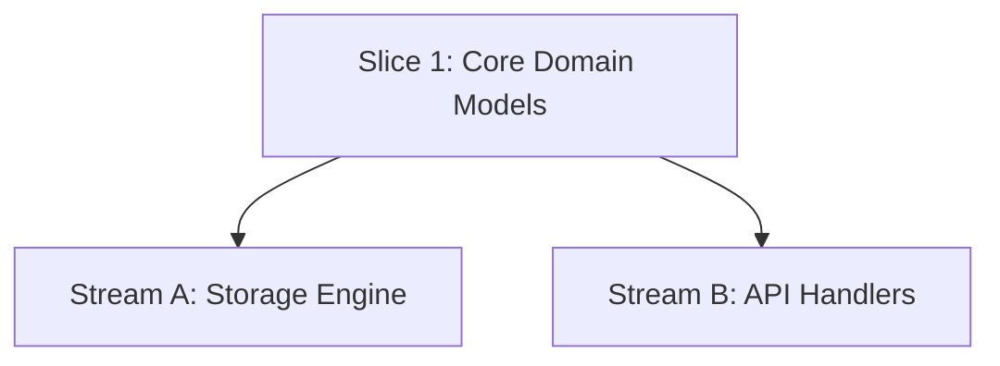

# How-To: Parallel Worktrees & Multi-Agent Streams

When a feature contains orthogonal tasks with zero mutual dependencies, SDTRD isolates execution across Git worktrees to prevent branch contamination and enable parallel subagent execution.

---

## 1. Identify Orthogonal Streams (Gate 4)

In `specs/features/<feature>/tasks.md`, analyze the dependency DAG:



- `Stream A` and `Stream B` depend on `Core`, but do not depend on each other.
- They can execute concurrently in separate Git worktrees.

---

## 2. Spawn Worktrees

Ensure your base feature branch is committed and up to date:

```bash
git checkout feat/01-data-pipeline
```

Spawn isolated worktrees:

```bash
git worktree add .worktrees/01-storage -b feat/01/storage
git worktree add .worktrees/01-api -b feat/01/api
```

---

## 3. Dispatch Agents to Worktrees

When delegating tasks to subagents:
- Point the subagent workspace directly to `.worktrees/01-storage`.
- In Antigravity / AGY, configure subagent invocation with `Workspace: 'share'` or point to the worktree path.
- The subagent executes Gate 5.x (BDD $\rightarrow$ Unit Red $\rightarrow$ Code Green $\rightarrow$ Mutation Kill) completely isolated inside its worktree.

---

## 4. Integrate Streams Back to Feature Branch

When Stream A completes and passes Gate 5.x:

1. Checkout the feature branch:
   ```bash
   git checkout feat/01-data-pipeline
   ```
2. Fast-forward merge the stream:
   ```bash
   git merge --ff-only feat/01/storage
   ```
3. Remove the completed worktree and delete the stream branch:
   ```bash
   git worktree remove .worktrees/01-storage
   git branch -d feat/01/storage
   ```

---

## 5. Rebase Dependent Streams

If Stream B requires code introduced by Stream A:

```bash
cd .worktrees/01-api
git rebase feat/01-data-pipeline
```

Resolve any rebasing conflicts inside the worktree, run the test suite, and continue execution.
