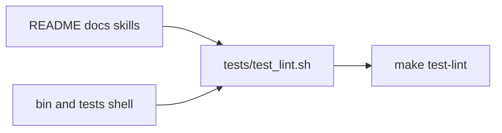

# Architecture & Technical Design

## 1. Overview & Invariants
Extends `tests/test_lint.sh` with two checks; deletes dead helpers; edits docs.
- Invariant: `bin/spec-rails-check` behavior unchanged; `openspec/spec-rails/spec-rails-check` stays byte-identical (REQ-OSA-22).
- Invariant: `specs/WORKFLOW.md` gate semantics unchanged.

## 2. Domain Models, State & Interface Contracts
- Unused-helper check: for each file in `bin/*` and `tests/**/*.sh`, extract `^name()` definitions with grep; fail if the name occurs fewer than twice in that file (definition plus one use). A helper defined in one file and used from another is out of scope today (none exist).
- Link check: extract `](relative/path)` targets (skip `http` and `#anchors`) from README, `docs/**/*.md`, `skills/**/*.md`; resolve against the file's directory; print `FAIL: <doc> -> <link>` if missing.
- Docs flow to document: `openspec new change <id>` -> `openspec instructions <artifact> --change <id>` (or `/opsx-propose`) -> human ticks gates -> `/opsx-apply` -> `openspec archive`.

## 3. Architecture Diagram & Data Flow

## 4. Boundary Rules & Budgets
- **Pure Core vs. I/O Shell**: checks are read-only greps; no network, no writes.
- **Concurrency, Latency & Resource Budgets**: under 2 s combined (NFR-OSA-7), sequential grep over about 40 files.

## 5. Testing Strategy
1. **BDD Scenarios**: add `docs_lint.feature` with broken link, unused helper and clean pass.
2. **Unit Tests (>= 95% coverage)**: run the checks against a fixture dir with a broken link and an unused function (must fail) and against the repo (must pass).
3. **Mutation Testing (100% kill)**: manual mutants (skip every `#` link, off-by-one on the use count, ignore `docs/how-tos`); each must make a fixture test fail.

## Review Gate
- [x] **Gate 3 Approval**: Architecture & design reviewed and approved by human before task breakdown.
