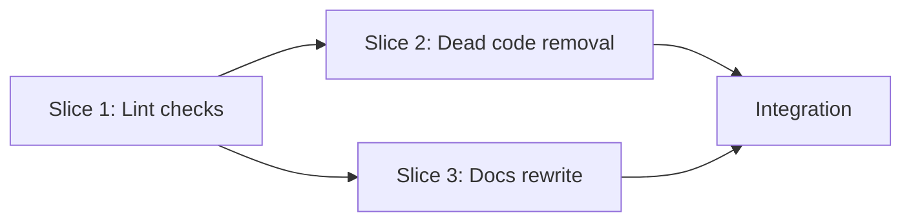

# Tasks

## 1. Dependency DAG

Slices 2 and 3 are independent after Slice 1 but touch few files; a single stream is enough.

## 2. Streams & Worktrees
| Stream | Worktree Path | Branch | Prerequisite |
| :--- | :--- | :--- | :--- |
| main | `.worktrees/w3-10-cleanup-docs` | `feat/w3-10-cleanup-docs` | Gate 4 approved |

## 3. Slice 1: Docs-link and unused-helper lint (REQ-OSA-23, 24, NFR-OSA-7)

- [x] 3.1 BDD scenarios for broken link, unused helper, clean pass (verify: `.feature` committed)
- [x] 3.2 Gate 5.1 human sign-off on BDD scenarios
- [x] 3.3 Red: fixture tests fail because the checks do not exist; repo then reports `gate_ticked` and `assert_dir` (verify: output shown)
- [x] 3.4 Green: implement both checks in `tests/test_lint.sh` (verify: fixtures pass/fail as expected, under 2 s)
- [x] 3.5 Coverage >= 95% and mutation 100% kill (verify: the three manual mutants each fail a fixture)

## 4. Slice 2: Dead code removal

- [x] 4.1 Remove `gate_ticked` from `bin/spec-rails-check` and its test block in `tests/test_check.sh`; sync `openspec/spec-rails/spec-rails-check` (verify: `make test`, self-copy test green)
- [x] 4.2 Remove `assert_dir` from `tests/bdd/test_bdd.sh` (verify: `make test-bdd`)

## 5. Slice 3: Docs (chore lane, no behavior change)

- [x] 5.1 Rewrite how-to 02 and `skills/spec-rails/SKILL.md` to the OpenSpec-native flow; drop manual `cp` (verify: grep finds no `cp openspec/schemas`)
- [x] 5.2 Update how-to 01 (roadmap note), README gate list (add Gate 0, slice loop, Gate 6), repo layout and roadmap link label (verify: link check passes)
- [x] 5.3 Fix contradictions in `docs/WIKI.md` and `docs/WAY_OF_WORKING.md` (verify: review diff; link check passes)

## 6. Integration & Rebase Plan
- [ ] 6.1 Rebase on main, re-verify rails, `openspec validate w3-10-cleanup-docs`, then `openspec archive`

## Review Gate
- [x] **Gate 4 Approval**: Tasks breakdown approved by human before writing test code.
