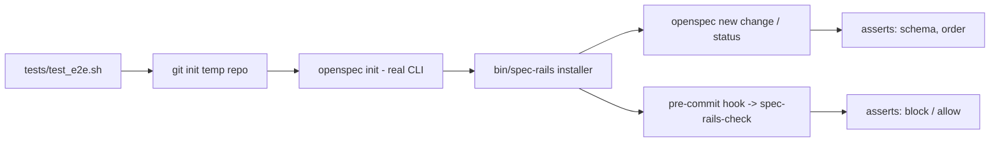

# Architecture & Technical Design

## 1. Overview & Invariants
One new POSIX shell test, `tests/test_e2e.sh`, drives the real `openspec` CLI and `bin/spec-rails` in a throwaway repo. It adds no production code. Invariants: the test never touches this repo's working tree or the network; it removes its temp dir on any exit; a missing tool is a reported skip.

## 2. Domain Models, State & Interface Contracts
- Inputs: `openspec` and `jq` on PATH; `bin/spec-rails` and `bin/spec-rails-check` from this repo.
- Test state: `SCRATCH` (mktemp dir), counters `PASSED`/`FAILED`, same `assert_*` style as `tests/test_installer.sh`.
- Exit: 0 when all asserts pass or the run is skipped; 1 on any failure.
- Steps in the temp repo `P`:
  1. `git init -b main`, set local `user.name`/`user.email`.
  2. `openspec init` non-interactively (flags confirmed from `openspec init --help` at implementation time; ASM-GEN-1).
  3. `sh bin/spec-rails "$P"`.
  4. `git checkout -b feat/demo`, `openspec new change demo`.
  5. `openspec status --change demo --json | jq`: assert `schemaName == "spec-rails"` and the artifact id order.
  6. Write `research.md` (unticked gate) and `proposal.md`; `git add` and `git commit`; assert non-zero and the output names the gate.
  7. Tick the Gate 0 box; commit `research.md` alone, then `proposal.md`; assert success.

## 3. Architecture Diagram & Data Flow

## 4. Boundary Rules & Budgets
- **Pure Core vs. I/O Shell**: the test is all shell I/O by nature; asserts are small helpers (`assert_eq`, `assert_contains`, `assert_fails`) with no side effects.
- **Concurrency, Latency & Resource Budgets**: sequential; under 20 s (NFR-OSA-8); no network, no installs; `trap` cleans `SCRATCH`.
- **Skip rule**: `command -v openspec` and `command -v jq` checked first; print `SKIP:` and exit 0.

## 5. Testing Strategy
1. **BDD Scenarios**: `tests/bdd/features/fresh_repo_e2e.feature` documents the five REQ-OSA-25 scenarios (documentation only, like the others).
2. **Unit Tests (>= 95% coverage)**: the e2e test is the test; no production code is added. Coverage target applies to the asserts: every scenario of REQ-OSA-25 and NFR-OSA-8 maps to at least one assert.
3. **Mutation Testing (100% kill)**: manual mutants, each must fail the test: (a) installer skips `set_schema_line`, (b) hook not installed, (c) `spec-rails-check` always exits 0. Mutants are applied to a copy of the repo scripts via `SPEC_RAILS_BIN`/PATH overrides, never to the working tree.

## Review Gate
- [x] **Gate 3 Approval**: Architecture & design reviewed and approved by human before task breakdown.
