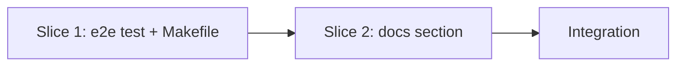

# Tasks

## 1. Dependency DAG

One slice drives the behavior; docs follow it. No parallel streams are warranted.

## 2. Streams & Worktrees
| Stream | Worktree Path | Branch | Prerequisite |
| :--- | :--- | :--- | :--- |
| main | `.worktrees/w3-11-fresh-repo-e2e` | `feat/w3-11-fresh-repo-e2e` | Gate 4 approved |

## 3. Slice 1: Fresh-repo end-to-end test (REQ-OSA-25, NFR-OSA-8)

- [x] 3.1 BDD scenarios in `tests/bdd/features/fresh_repo_e2e.feature` (verify: `.feature` committed)
- [x] 3.2 Gate 5.1 human sign-off on BDD scenarios
- [x] 3.3 Red: `make test-e2e` target and `tests/test_e2e.sh` skeleton fail because the asserts are not satisfied or the target is missing (verify: output shown)
- [x] 3.4 Green: implement the steps from design §2 with the skip rule and `trap` cleanup; wire `test-e2e` into `make test` (verify: `make test-e2e` passes in under 20 s; run with `openspec` hidden from PATH prints SKIP and exits 0)
- [x] 3.5 Coverage and mutation: every REQ-OSA-25 scenario has an assert; the three manual mutants (no schema line, no hook, check always passes) each fail the test (verify: outputs shown); `git status` of the repo unchanged after the run

## 4. Slice 2: Docs

- [x] 4.1 Add a "Try it in a new repo" section to `docs/how-tos/01-bootstrap-new-project.md` linking `tests/test_e2e.sh` (verify: `make test-lint` link check passes)

## 5. Integration & Rebase Plan
- [x] 5.1 Rebase on main, re-verify rails (`make test`), `openspec validate w3-11-fresh-repo-e2e`, then `openspec archive`; mark W3.11 in `specs/ROADMAP.md` via `chore/roadmap-w3-11`

## Review Gate
- [x] **Gate 4 Approval**: Tasks breakdown approved by human before writing test code.
