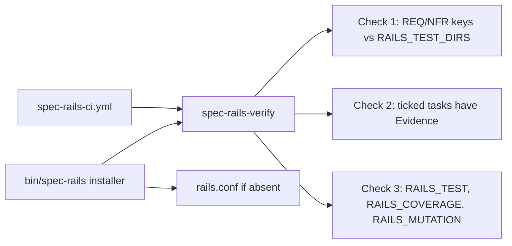

# Architecture & Technical Design

## 1. Overview & Invariants
One new POSIX shell script, `bin/spec-rails-verify`, run only by CI. It performs three independent checks and exits 1 if any fails, printing every failure. Invariants: read-only on the repo; no language-specific tools; no network; missing config is a warning.

## 2. Domain Models, State & Interface Contracts
- `openspec/spec-rails/rails.conf` is sourced as shell (`. file`). Variables: `RAILS_TEST_DIRS` (default `tests`), `RAILS_TEST`, `RAILS_COVERAGE`, `RAILS_MUTATION`. It is created by the installer only if absent, from `templates/rails.conf` (all commands commented out).
- Check 1 (REQ-OSA-26): for each `openspec/changes/*/specs/**/spec.md` (not `archive/`), extract keys from header lines `### Requirement: (REQ|NFR)-...` that sit under an ADDED or MODIFIED section; `grep -rqF` each key in `RAILS_TEST_DIRS`. Report uncovered keys.
- Check 2 (REQ-OSA-27): for each active `tasks.md`, lines matching `^- \[x\].*(Red|Green|Coverage|[Mm]utation)` must match `Evidence: *[^ ]`. Report offenders with file and line.
- Check 3 (REQ-OSA-28): run `RAILS_TEST`, `RAILS_COVERAGE`, `RAILS_MUTATION` via `sh -c`, in that order, stop at the first failure; warn for each undefined one.
- Exit: 0 all pass; 1 any failure. Usage: `sh openspec/spec-rails/spec-rails-verify`.

## 3. Architecture Diagram & Data Flow

## 4. Boundary Rules & Budgets
- **Pure Core vs. I/O Shell**: key extraction and evidence matching are small functions that print results; command execution is isolated in one function.
- **Budgets**: own checks under 5 s (NFR-OSA-9); user commands unbounded by Spec-Rails.
- **Self-copy**: `bin/spec-rails-verify` and `openspec/spec-rails/spec-rails-verify`, and `templates/rails.conf` and its copy, are byte-identical (extend `tests/test_selfcopy.sh`). The CI template and workflow stay identical.
- The hook script (`bin/spec-rails`) is not changed to call the verifier.

## 5. Testing Strategy
1. **BDD Scenarios**: `tests/bdd/features/test_rails_ci.feature` mirrors the scenarios of REQ-OSA-26 to 28 and NFR-OSA-9 (documentation only).
2. **Unit Tests (>= 95% coverage)**: `tests/test_verify.sh` builds fixture repos in a temp dir and asserts pass/fail for each scenario; every branch of the script is hit by at least one case.
3. **Mutation Testing (100% kill)**: manual mutants, each must fail `test_verify.sh`: key check always passes, evidence check inverted, command failure ignored, installer overwrites `rails.conf`.

## Review Gate
- [x] **Gate 3 Approval**: Architecture & design reviewed and approved by human before task breakdown.
