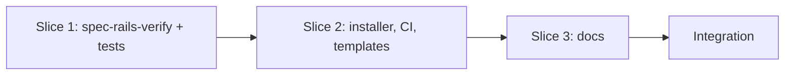

# Tasks

## 1. Dependency DAG

Slices are sequential; no parallel streams are warranted.

## 2. Streams & Worktrees
| Stream | Worktree Path | Branch | Prerequisite |
| :--- | :--- | :--- | :--- |
| main | `.worktrees/w3-12-test-rails-ci` | `feat/w3-12-test-rails-ci` | Gate 4 approved |

## 3. Slice 1: Verifier (REQ-OSA-26, REQ-OSA-27, REQ-OSA-28, NFR-OSA-9)

- [x] 3.1 BDD scenarios in `tests/bdd/features/test_rails_ci.feature` (verify: `.feature` committed)
- [x] 3.2 Gate 5.1 human sign-off on BDD scenarios
- [x] 3.3 Red: `tests/test_verify.sh` fixtures fail because `bin/spec-rails-verify` is missing (verify: output shown). Evidence: `sh tests/test_verify.sh` -> "FAIL: bin/spec-rails-verify missing", exit 1
- [x] 3.4 Green: implement `bin/spec-rails-verify` per design §2; wire `test-verify` into `make test` (verify: suite passes). Evidence: `make test` -> rc 0, "verify: 14 passed, 0 failed"
- [x] 3.5 Coverage and mutation: every scenario has a case; the four manual mutants each fail the test (verify: outputs shown). Evidence: mutants (key check, evidence check, command failure, section filter) all "killed"

## 4. Slice 2: Installer, CI and templates

- [x] 4.1 Installer copies `spec-rails-verify` and creates `rails.conf` only if absent; add `templates/rails.conf`; extend `tests/test_installer.sh` (verify: existing file preserved)
- [x] 4.2 Add "Verify Test Rails" step to `templates/spec-rails-ci.yml` and `.github/workflows/spec-rails-ci.yml`; extend `tests/test_selfcopy.sh` (verify: pair identical, hook does not call verifier; `test_ci_audit.sh` needs no change because the audit step is untouched)
- [x] 4.3 Add the `Evidence:` convention to the schema `tasks.md` template and the `apply` instruction in both schema copies (verify: `make test-schema`, self-copy test)

## 5. Slice 3: Docs

- [x] 5.1 Document `rails.conf`, `spec-rails-verify` and the `Evidence:` convention in the README, wiki and how-to 01 (verify: `make test-lint` link check passes)

## 6. Integration & Rebase Plan
- [ ] 6.1 Rebase on main, re-verify rails (`make test`), `openspec validate w3-12-test-rails-ci`, then `openspec archive`; mark W3.12 in `specs/ROADMAP.md` via `chore/roadmap-w3-12`

## Review Gate
- [x] **Gate 4 Approval**: Tasks breakdown approved by human before writing test code.
