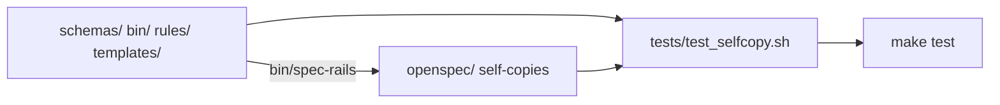

# Architecture & Technical Design

## 1. Overview & Invariants
Two small edits plus housekeeping; no change to installer or check behavior.
- Invariant: sources (`schemas/`, `bin/`, `rules/`, `templates/`) remain the single authoring location; `openspec/` copies are installer output.
- Invariant: chore-lane exemption in the CI audit is unchanged.

## 2. Domain Models, State & Interface Contracts
- CI audit: `SPEC_CHANGES=$(echo "$CHANGED_FILES" | grep -E '^(openspec/(changes|specs)/|specs/bug-reports/)' || true)`. The `CODE_CHANGES` exclusion regex adds `openspec/` so spec edits are not counted as code.
- `tests/test_selfcopy.sh`: for each `src dst` pair runs `diff -r src dst`; prints `FAIL: <path>` and exits 1 on any difference. Wired as `make test-selfcopy` and added to `test`.

## 3. Architecture Diagram & Data Flow

## 4. Boundary Rules & Budgets
- **Pure Core vs. I/O Shell**: no core logic; the shell script only compares files. The CI regex is a pure string filter.
- **Concurrency, Latency & Resource Budgets**: sync test < 2 s (NFR-OSA-6); sequential `diff` of ~15 small files.

## 5. Testing Strategy
1. **BDD Scenarios**: add scenarios to `tests/bdd/features/openspec_installer.feature` for drift detected and in-sync; CI audit scenarios exercise the extracted filter against a temp git repo.
2. **Unit Tests (>= 95% coverage)**: `tests/test_selfcopy.sh` covers match, mismatch, and missing file branches; audit logic tested by running the same grep pipeline on fixture file lists.
3. **Mutation Testing (100% kill)**: manual mutants (drop a pair, loosen the audit regex, revert to legacy paths); each must make a test fail.

## Review Gate
- [x] **Gate 3 Approval**: Architecture & design reviewed and approved by human before task breakdown.
