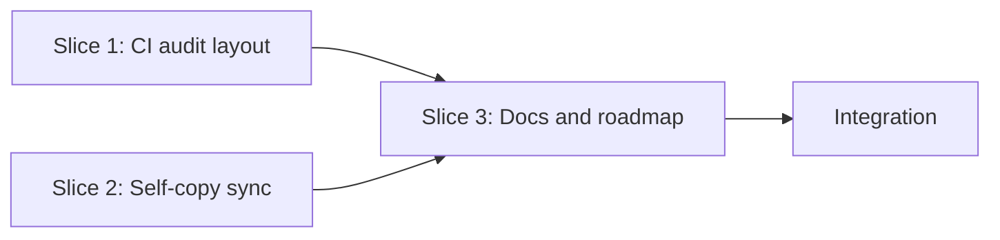

# Tasks

## 1. Dependency DAG

Slices 1 and 2 are independent; no parallel streams are needed.

## 2. Streams & Worktrees
| Stream | Worktree Path | Branch | Prerequisite |
| :--- | :--- | :--- | :--- |
| main | `.worktrees/w3-9-addon-hygiene` | `feat/w3-9-addon-hygiene` | Gate 4 approved |

## 3. Slice 1: CI audit layout (REQ-OSA-21)

- [x] 3.1 BDD scenarios for audit pass/fail (verify: `.feature` committed)
- [x] 3.2 Gate 5.1 human sign-off on BDD scenarios
- [x] 3.3 Red tests: audit filter rejects legacy paths and accepts `openspec/changes/` (verify: fails before edit)
- [x] 3.4 Green: update `templates/spec-rails-ci.yml` and `.github/workflows/spec-rails-ci.yml` (verify: `make test`, both files identical)
- [x] 3.5 Coverage >= 95% and mutation 100% kill (verify: loosened-regex mutant fails a test)

## 4. Slice 2: Self-copy sync (REQ-OSA-22, NFR-OSA-6)

- [x] 4.1 BDD scenarios for drift and in-sync (verify: `.feature` committed)
- [x] 4.2 Gate 5.2 human sign-off on BDD scenarios
- [x] 4.3 Red: `tests/test_selfcopy.sh` fails when a copy is altered (verify: output shown)
- [x] 4.4 Green: script plus `make test-selfcopy` wired into `test` (verify: suite passes, < 2 s)
- [x] 4.5 Coverage >= 95% and mutation 100% kill (verify: dropped-pair mutant fails)

## 5. Slice 3: Docs, roadmap, test fixtures (chore lane)

- [x] 5.1 Fix `tests/bdd/test_bdd.sh` stale `specs/templates/` paths (verify: `make test-bdd`)
- [x] 5.2 Update `specs/ROADMAP.md` statuses and `test_init.sh` reference; reconcile or remove `docs/ROADMAP.md` (verify: grep finds no `test_init.sh`)
- [x] 5.3 Remove no-op `test-unit` target; pin `action-shellcheck`; align `actions/checkout` (verify: `make test`)

## 6. Integration & Rebase Plan
- [x] 6.1 Rebase on main, re-verify rails, `openspec validate w3-9-addon-hygiene`, then `openspec archive`

## Review Gate
- [x] **Gate 4 Approval**: Tasks breakdown approved by human before writing test code.
