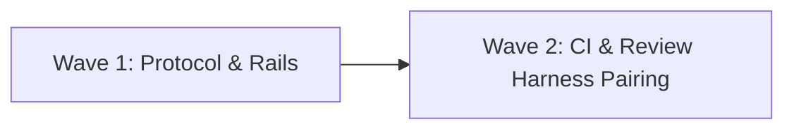

# SDTRD Project Roadmap

Baseline: `main` · Status: Active

---

## 1. Dependency Spine & Waves

---

## 2. Work Items & Backlog

Status Legend (changed only on `main` via `chore/roadmap-<id>` branches; see `specs/WORKFLOW.md` §2):
- `⬜ Planned`: Scheduled for execution.
- `🔬 In Research (Gate 0)`: Actively investigating technical feasibility and options.
- `🚀 In Progress (Gates 1–6)`: Gate 0 Go decision made; active feature branch / worktree streams.
- `✅ Shipped`: Verified, merged, living specs synced, archived.
- `❌ Dropped`: Discarded at Gate 0; rationale here, research in `specs/archive/<id>-<slug>/`.

### Wave 1: Protocol, Lifecycle & Core Templates

| ID | Item | Effort | Depends on | Status | Spec / Feature Dir | Notes |
| :--- | :--- | :--- | :--- | :--- | :--- | :--- |
| **W1.1** | Canonical Workflow Protocol | M | — | ✅ | `specs/WORKFLOW.md` | Language-agnostic Gates 0–6, Worktrees, Rails |
| **W1.2** | Lifecycle Markdown Templates | S | W1.1 | ✅ | `templates/` | `research.md`, `proposal.md`, `spec.md`, `design.md`, `tasks.md`, `bug-report.md`, `roadmap.md` |
| **W1.3** | Project Initializer Script | S | W1.2 | ✅ | `bin/sdtrd` | Scaffolds `specs/` and `.gitignore` idempotently |
| **W1.4** | Automated Test Suite | S | W1.3 | ✅ | `tests/test_init.sh` | Shell assertions + `Makefile` runner |

### Wave 2: CI & Review Harness Pairing

| ID | Item | Effort | Depends on | Status | Spec / Feature Dir | Notes |
| :--- | :--- | :--- | :--- | :--- | :--- | :--- |
| **W2.1** | Pre-Commit Integration | S | W1.1 | ✅ | `.pre-commit-config.yaml` | Zero-bypass formatting, linting, tests |
| **W2.2** | Reusable GitHub CI Workflow | S | W1.2 | ✅ | `templates/sdtrd-ci.yml` | Spec-to-code audit + testing rail verification |
| **W2.3** | LGTM Review Pairing Specs | M | W1.1 | ✅ | `docs/WIKI.md` | Line-anchored `#ref` steering and anti-fraud guardrails |
| **W2.4** | Chore Lane & Contradiction Pruning | S | W1.1, W2.2 | ✅ | `specs/WORKFLOW.md` | Red-commit policy, chore lane, full-copy spec rule |

---

## 3. Wave Exit Criteria

### Wave 1 Exit Criteria
- [x] All W1 items marked `✅ Shipped`.
- [x] 100% test pass on initializer suite.
- [x] Language-agnostic workflow free of stack-specific leaks.

### Wave 2 Exit Criteria
- [x] All W2 items marked `✅ Shipped`.
- [x] GitHub Actions workflow template verified.
- [x] Pre-commit hook active with zero bypass allowed.
