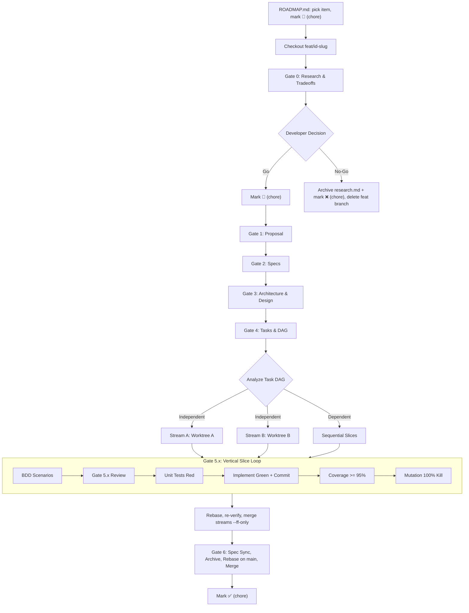
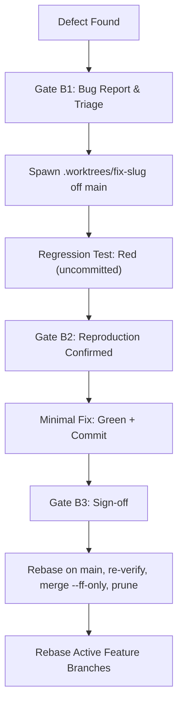

# Spec-Driven, Testing-Railed Development (Spec-Rails) Workflow

## 1. Lanes, Branching & Worktrees

### Rule 0: Pick the Right Lane

Every change travels through exactly one lane. Pick it before touching anything.

| Lane | Branch | Use When | Gates |
| :--- | :--- | :--- | :--- |
| **Feature** | `feat/<id>-<slug>` | New or changed behavior | 0 → 6 (§2, §4, §6) |
| **Bugfix** | `fix/<slug>` | Merged behavior contradicts spec, docs, or user intent | B1 → B3 (§3) |
| **Chore** | `chore/<slug>` | Zero behavior change: docs, formatting, tooling/CI config, refactors that keep every existing test unchanged | None (Rule 5) |

- `<id>` is the work item ID from `specs/ROADMAP.md`, lowercased (e.g., roadmap `W1.2` → `feat/w1.2-data-ingestion`, `openspec/changes/w1.2-data-ingestion/`).
- If a chore turns out to change behavior, stop and restart in the Feature or Bugfix lane.

### Rule 1: Never Commit on `main`
- **NEVER** commit directly to `main` / `master`. Every commit lands through a lane branch merged with `--ff-only`.
- All research, proposal, specs, design, tasks, and slice work commits to the feature branch.

### Rule 2: Rebase & Re-Verify Before Every Merge
`--ff-only` fails when the target moved. Before merging any branch (feature, fix, chore, or stream) into its target:
```bash
git rebase <target-branch>
# Re-run pre-commit + full test suite (+ mutation suite where the lane requires it) on the rebased branch
git checkout <target-branch>
git merge --ff-only <branch>
```
Never merge a branch whose rails were verified only against a stale base.

### Rule 3: Multi-Agent Parallel Streams via Git Worktrees
- When slices have **no mutual dependencies** (orthogonal modules, distinct capabilities, decoupled tests):
  1. **Contract Lock**: Shared domain types, interfaces, or contracts MUST be implemented, tested, and committed to the feature branch *before* spawning parallel worktrees.
  2. **Worktree Hygiene**:
     - `.worktrees/` MUST be in root `.gitignore`.
     - **Stale lock safety**: If git reports `.git/index.lock` exists, first verify no git process is running (`pgrep -fl git`). Remove the lock only when none is running. Never delete a lock while another agent may be mid-operation; doing so can corrupt the index.
     - **Shared config invariant**: Worktree operations MUST NEVER mutate shared repository config. If `core.bare` was flipped to `true`, restore it with `git config core.bare false`.
  3. **Spawn Isolated Worktree**:
     ```bash
     git worktree add .worktrees/<id>-<stream> -b feat/<id>/<stream>
     ```
  4. **Path Resolution**: Tests and modules MUST resolve paths relative to the project root or Git boundary, never hardcoded parent traversal. Reuse the project's shared build cache and dependencies inside worktrees.
  5. **Subagent Dispatch & Gate Escalation**:
     - The orchestrating agent dispatches one subagent per stream, scoped to its worktree.
     - **Hard Prohibition**: Subagents **NEVER** self-approve any human gate (0–6, 5.x, B1–B3) or skip ahead into code.
     - **Escalation**: On completing a gate artifact, the subagent halts and reports to the orchestrating agent, which presents the artifact to the human. Clearance flows back only after explicit human approval.
  6. **Stream Merge Sequence**: First finished stream merges into the feature branch `--ff-only`. Every later stream follows Rule 2 (rebase onto the updated feature branch, re-run unit + slice mutation suite), then merges `--ff-only`. Clean up the worktree completely after each merge:
     ```bash
     git worktree remove .worktrees/<id>-<stream>
     git branch -d feat/<id>/<stream>
     git worktree prune
     ```
  7. **Shared File Collision Protocol**: When streams touch shared dispatch, routing, or harness files (key matchers, enum routers, status bars, BDD runners), resolve conflicts **strictly additively**: keep both streams' registrations, handlers, and test cases. NEVER drop another stream's registrations or assertions.

### Rule 4: Pre-Commit Hooks & Red-Commit Policy
- **Install hooks**: Every project MUST configure `.pre-commit-config.yaml` and run `pre-commit install`.
- **Before every commit**:
  1. Inspect `git status` and `git diff`.
  2. Run all linters and formatters (`pre-commit run --all-files` or equivalent).
  3. Run the full unit and integration suite.
- **Zero bypass**: `git commit --no-verify` / `-n` is forbidden. Fix the failure instead.
- **Red is never committed alone**: Red tests are written and verified failing locally (output shown to the human where a gate requires it), then committed together with the Green implementation that makes them pass. The tip of every branch is always green.

### Rule 5: Chore Lane
1. `git checkout -b chore/<slug>` from the target branch.
2. Make the change. Refactors MUST keep every existing test unchanged and green; touched core modules MUST keep a 100% mutation kill score.
3. Commit through pre-commit (Rule 4).
4. Merge per Rule 2, then delete the branch.

---

## 2. Feature Lifecycle & Human Gates

### Canonical Directory Layout
```text
specs/
├── WORKFLOW.md     <-- Operating procedures and gate rails
├── ROADMAP.md      <-- Waves, work items, dependency spine, exit criteria
├── features/       <-- Active features: research, proposal, design, tasks, specs
├── living/         <-- Canonical specs of shipped capabilities (ground truth)
├── archive/        <-- Lifecycle artifacts of shipped or dropped features
├── bug-reports/    <-- Defect triage reports
└── templates/      <-- Lifecycle markdown templates
```

### Gate Approval Evidence
A gate passes only when the agent, after explicit human approval, ticks the artifact's **Review Gate** checkbox and commits it. An unticked box means the gate has not passed, whatever was said in chat.

### ROADMAP.md Updates (Main-Only via Chore Lane)
`specs/ROADMAP.md` is never edited on feature branches; that avoids conflicts between parallel features and keeps status visible on `main`. Status changes land through a tiny `chore/roadmap-<id>` branch merged per Rule 2:

| Moment | Status Change |
| :--- | :--- |
| Gate 0 start | `⬜` → `🔬 In Research` |
| Gate 0 decision: Go | `🔬` → `🚀 In Progress` |
| Gate 0 decision: No-Go | `🔬` → `❌ Dropped` + rationale; also commits `research.md` to `openspec/changes/archive/<id>-<slug>/` |
| Gate 6 end (after feature merge) | `🚀` → `✅ Shipped` |



### Gate 0: Research & Tradeoffs
- **Purpose**: Explore briefly and let the developer decide *before* committing to build, so nothing gets built on opinionated, unverified assumptions.
- **Artifact**: `openspec/changes/<id>-<slug>/research.md`
- **Mandatory Sections**:
  - **Intent & Ground Truth**: Problem, existing constraints, facts verified in the codebase or official docs.
  - **Explored Options (2–3)**: e.g., idiomatic library vs minimal in-house vs specialized.
  - **Tradeoff Matrix**: Complexity, dependencies, performance, maintenance, blast radius.
  - **Breaking Changes & Deprecations**: Every `REQ-*` / `NFR-*` in `openspec/specs/` that will be modified, superseded, or deprecated.
  - **Recommendation**: 1–2 sentences, YAGNI-first.
- **Gate**: Developer decides **Go** (option chosen → Gate 1) or **No-Go** (archive research to `main` via chore, mark `❌`, delete the feature branch).

### Gate 1: Proposal
- **Artifact**: `openspec/changes/<id>-<slug>/proposal.md`
- **Mandatory Sections**: Intent, Problem Statement, Scope (In-Scope / Out-of-Scope YAGNI), Success Metrics, Assumptions (`ASM-GEN-*`), built on the option chosen at Gate 0.
- **Gate**: Human approval before drafting specs.

### Gate 2: Specifications
- **Artifacts**: `openspec/changes/<id>-<slug>/specs/<capability>/spec.md`
- **Delta Specs**: Feature specs are OpenSpec delta specs (`## ADDED|MODIFIED|REMOVED Requirements`), never full copies.
  - **Existing capability**: MODIFIED/REMOVED deltas repeat the existing requirement header exactly. Deprecated keys stay, marked `[DEPRECATED by <id>]`; keys are never reused.
  - **New capability**: ADDED requirements, starting with `## Purpose`.
  - Headers are `### Requirement: REQ-<DOMAIN>-<N> <name>`; bodies contain `MUST`/`SHALL`; every requirement has at least one `#### Scenario:`.
  - `openspec archive` merges the deltas into `openspec/specs/` at Gate 6.
- **Mandatory Sections**: Functional Requirements (`REQ-*`), Non-Functional Requirements & Budgets (`NFR-*`), Assumptions (`ASM-*`), Edge Cases & Errors, Behavioral Scenarios (`Given / When / Then`).
- **Traceability**: Every requirement uniquely keyed (`REQ-<DOMAIN>-<N>`, `NFR-<DOMAIN>-<N>`).
- **Gate**: Human approval before technical design.

### Gate 3: Architecture & Design
- **Artifact**: `openspec/changes/<id>-<slug>/design.md`
- **Mandatory Sections**: Overview & Invariants; Domain Models, State & Interface Contracts; Architecture Diagrams & Data Flow; Boundary Rules (Pure Core vs I/O Shell); Concurrency, Latency & Resource Budgets (matching `NFR-*`); Testing Strategy.
- **Domain-Specific Baselines**:
  - **UI / Interactive**: Frame deadlines (e.g., $< 16\text{ms}$), input latency budgets, background I/O offloading.
  - **ML / Data / Heuristics**: Deterministic Tier 0 baseline before complex models or external APIs.
- **Gate**: Human approval before task breakdown.

### Gate 4: Tasks & DAG
- **Artifact**: `openspec/changes/<id>-<slug>/tasks.md`
- **Mandatory Sections**: Dependency DAG; Streams with worktrees (`.worktrees/<id>-<stream>`); test-first order per slice (BDD → Gate 5.x → Red → Green → Coverage → Mutation); Integration & Rebase Plan.
- **Gate**: Human approval before spawning worktrees or writing tests.

---

## 3. Bugfix Lane & Fast-Track Gates

- **Scope**:
  - **In-flight slice defect** (inside the slice being built): fix in that slice's branch with an immediate Red-first test. No extra gates.
  - **Merged / cross-cutting / dogfood defect**: full lane below.
- **Hard Prohibition**: Never touch production code on `main` or in a dirty feature directory.



### Gate B1: Bug Report & Triage
- **Artifact**: `specs/bug-reports/<date>-<slug>.md`
- **Mandatory Sections**: Status & Metadata, Summary, Steps to Reproduce, Expected vs Actual, Root Cause Analysis, Remediation Plan.
- **Gate**: Human approval before code changes.

### Gate B2: Reproduction Confirmed (Red-First)
- `git worktree add .worktrees/fix-<slug> -b fix/<slug> main`
- Write the regression test *before touching production code*. It MUST fail on unmodified code.
- Show the failing output to the human. The Red test stays uncommitted (Rule 4).
- **Gate**: Human confirms the test reproduces the real defect.

### Gate B3: Sign-off & Merge
- Apply the minimal fix (Green), run the full suite, commit test + fix together.
- **Spec & doc integrity**: If the defect stems from or affects living specs or docs, fix `openspec/specs/` and docs in the same branch.
- Human reviews the final diff and test output.
- Merge per Rule 2, clean up worktree completely (`git worktree remove .worktrees/fix-<slug>`, `git branch -d fix/<slug>`, `git worktree prune`), mark the report `Resolved` with the commit hash, and rebase active feature branches onto `main`.

---

## 4. Gate 5.x: Vertical-Slice Apply Loop

`x` = slice number from `tasks.md`. Each slice runs three strict steps:

### Step 5.x-A: BDD Scenarios (100% Behavior Coverage)
- Write Gherkin scenarios (`tests/bdd/features/*.feature` or stack equivalent) covering all `REQ-*`, `NFR-*`, and boundaries.
- **Gate 5.x**: Present in ultra-compact bullets (title, key assertions, boundaries). Wait for explicit approval before writing tests.

### Step 5.x-B: Red → Green → Refactor ($\ge 95\%$ Coverage)
- **Red**: Write failing unit tests; verify they fail for the expected reason. Do not commit yet (Rule 4).
- **Green**: Minimal production code to pass (strict YAGNI). Commit tests + code together.
- **Refactor**: Under green protection.
- **Coverage**: Line and branch $\ge 95\%$ on the target module.
- **Performance**: Verify `NFR-*` budgets with deterministic benchmarks/assertions.

### Step 5.x-C: Mutation Testing (100% Kill, No Exemptions)
- **Scoped run**: Mutate only the slice's modules. Full-project mutation runs at Gate 6.
- **Every surviving mutant is a blocking defect**. Resolve by exactly one of:
  1. **Add a targeted assertion** that kills it.
  2. **Delete dead code**: unreachable defensive branches or assertions get removed (YAGNI).
  3. **Restructure equivalent mutants away**: when a mutant is behaviorally identical to the original (e.g., `i < n` → `i != n` in an index loop), rewrite the code so the equivalence disappears (iterators instead of index loops, removing redundant conditions), making the mutant killable or impossible.
- Never mask survivors with skip comments, exclusion lists, or lowered thresholds.
- **Target**: $100\%$ kill score on slice domain and core logic.

---

## 5. Coding Agents & Review Harness

Spec-Rails pairs with [mgabs/lgtm](https://github.com/mgabs/lgtm) as the review cockpit and agent steering harness.

- **Directive Preemption**: Review directives (`#ref file:line <directive>`) preempt all forward work. When directives exist in `.lgtm/reviews/` or chat, halt `tasks.md` execution, resolve every directive to clean verification, then resume.
- **Anchor Directives**: Resolve at the exact target line, verify tests pass, commit (Rule 4).
- **Review Inbox**: Check `.lgtm/reviews/` and inline directives every turn.
- **Test Integrity (Anti-Fraud)**:
  - NEVER delete or weaken assertions to force green (`lgtm`'s test-neutering guard will flag it).
  - NEVER write vacuous assertions or tautological mocks.
  - NEVER skip/ignore failing tests without explicit human sign-off.
- **Boundaries & Hygiene (The Ponytail Mindset & Strict YAGNI)**:
  - Strictly apply YAGNI (You Aren't Gonna Need It). Build strictly what is specified without speculative extras or premature abstractions.
  - Pure domain core: no direct I/O, network, or framework coupling.
  - Touch only files in the active slice (minimal blast radius).
  - No dead or unreferenced code (Ponytail rule: delete dead code when mutants survive).
  - No scratch files, debug dumps, or `.env` artifacts in the tree.

---

## 6. Gate 6: Living Spec Sync, Archive & Merge

All steps on the feature branch unless stated otherwise:

1. All stream worktrees merged into the feature branch (Rule 3.6), removed, and pruned (`git worktree prune`). Verify `git worktree list` shows only the repository root.
2. Rebase the feature branch onto `main` (Rule 2).
3. Full test suite: $100\%$ pass, $\ge 95\%$ line and branch coverage.
4. Full-project mutation suite: $100\%$ kill score on core logic.
5. Run `openspec validate <change>` (also required after every stream rebase).
6. Tick every item in `tasks.md` and the Gate 6 box.
7. Sync and archive in one step (no Spec-Rails-owned copy or move):
   ```bash
   openspec archive <id>-<slug> --yes
   ```
8. Commit, then merge into `main`:
   ```bash
   git checkout main
   git merge --ff-only feat/<id>-<slug>
   git branch -d feat/<id>-<slug>
   ```
9. Mark `✅ Shipped` in `specs/ROADMAP.md` via `chore/roadmap-<id>` (§2).

## 7. OpenSpec Layout & Enforcement

Spec-Rails is an addon on an OpenSpec project (`spec-rails [init] [dir]`, requires OpenSpec ≥ 1.15.0 and `jq`). OpenSpec owns the artifact graph, specs and archive; Spec-Rails supplies the `spec-rails` schema (`research → proposal → specs → design → tasks`), gates, lanes and testing rails.

- **Layout**: changes live in `openspec/changes/<id>-<slug>/`, capabilities in `openspec/specs/<capability>/spec.md`, finished changes in `openspec/changes/archive/`. `specs/ROADMAP.md`, `specs/WORKFLOW.md` and `specs/bug-reports/` stay under `specs/`.
- **Gates**: each artifact template ends with an unticked `## Review Gate` box. A human ticks it and commits it before the next artifact is created. `spec-rails-check` (pre-commit and CI) fails if an artifact exists whose upstream gate is unticked, and fails commits on `main`/`master`.
- **Streams**: after rebasing a stream onto the feature branch, run `openspec validate <change>` in addition to the test suite.
- **Requirement IDs**: `REQ-*`/`NFR-*` live in the change's delta specs and are synced into `openspec/specs/` by `openspec archive`; Gate 6 adds only the rails (tests, mutation, `openspec validate`) around that command.
- **Parallel streams and deltas**: streams of one change share its delta specs. Apply Rule 3.7 (strictly additive) to delta spec edits, and give each stream distinct `REQ-*` IDs to avoid collisions.
- **Bugfix lane**: B1–B3 stay outside `openspec/changes/`; the report in `specs/bug-reports/` is the artifact. A fix that alters a living requirement edits `openspec/specs/` directly in the same branch (B3), with no delta change.
- **Roadmap vs OpenSpec**: `specs/ROADMAP.md` tracks delivery status of initiatives (one row = one or more changes); OpenSpec tracks each change's artifacts. The row's Spec / Feature Dir points at the change or its archive.
- **Update survival**: Spec-Rails rules live in `openspec/spec-rails/`, outside files regenerated by `openspec update`.
