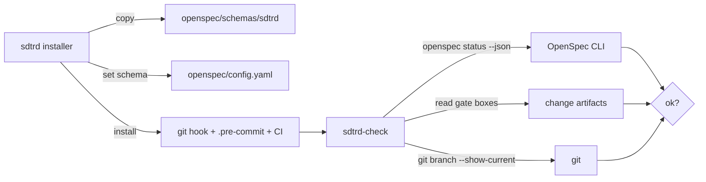

# Architecture & Technical Design: SDTRD as an OpenSpec Addon

## 1. Architectural Overview & Invariants

The addon is a file bundle plus two POSIX `sh` scripts layered on an existing OpenSpec project. OpenSpec owns the artifact graph, delta specs, validation and archive; SDTRD contributes (a) a `sdtrd` schema, (b) an installer that wires the bundle in, and (c) a gate/lane check run from pre-commit and CI. No OpenSpec code is modified or reimplemented.

### Key Invariants
1. **OpenSpec is the single source of truth for specs and artifact state**: SDTRD never copies, moves or parses spec content; artifact presence comes only from `openspec status --json` (REQ-OSA-9, 18).
2. **Installer is idempotent and non-destructive**: writes only if content differs; never overwrites user-owned files (REQ-OSA-13, 14).
3. **Checks fail closed**: any unparseable or missing input exits non-zero (Edge Case 5).
4. **No SDTRD files in OpenSpec-regenerated paths** (REQ-OSA-15).

### Verified facts (OpenSpec 1.15.0 source)
- `src/core/parsers/requirement-blocks.ts:38`: header regex is `^###\s*Requirement:\s*(.+)\s*$`; the whole remaining text is the requirement name, matched case-sensitively. A leading `REQ-OSA-8 ` key is therefore part of the name: **ASM-OSA-2 holds**. Consequence: MODIFIED/REMOVED deltas must repeat the full `REQ-… Name` header exactly.
- Validator requires `SHALL` or `MUST` in the requirement body (`validation/constants.ts:28`; guidance unless strict). SDTRD requirement text already uses `MUST`.
- `status --json` returns `artifacts: [{id, status: done|ready|blocked|skipped, requires}]` and `artifactPaths`, and `{changes: [], …}` with exit 0 when there are no changes (`docs/agent-contract.md` §4.4).

---

## 2. Domain Models, State & Interfaces

```text
Repo layout shipped by the addon:
  schemas/sdtrd/schema.yaml
  schemas/sdtrd/templates/{research,proposal,spec,design,tasks}.md   # each ends with Review Gate
  bin/sdtrd                    # installer: sdtrd [init] [target-dir]
  bin/sdtrd-check              # gate + lane check
  rules/AGENTS.md  skills/sdtrd/SKILL.md  templates/{.pre-commit-config.yaml,sdtrd-ci.yml,mutation/*}

Schema (sdtrd): research -> proposal -> specs -> design -> tasks ; apply.requires=[tasks], tracks=tasks.md

Gate map (artifact -> gate box that must be ticked before the NEXT artifact may exist):
  research=Gate 0 (Decision)  proposal=Gate 1  specs=Gate 2  design=Gate 3  tasks=Gate 4
  Box detection: a line matching  ^- \[x\]  inside the artifact's "## Review Gate" section
  (for research.md: the "Decision" line; specs: every specs/**/spec.md)

sdtrd-check exit codes: 0 ok | 1 violation | 2 environment/parse error
installer exit codes:   0 ok | 1 prerequisite failure
```

---

## 3. Architecture Diagram & Data Flow



Installer flow: check `openspec/` dir → check `openspec` on PATH and `--version` ≥ 1.15.0 → copy schema (cmp, write if different) → set `schema:` → install hooks/CI/templates/rules → ensure `.gitignore` entry → print summary.

Check flow: branch guard → `openspec list --json` for active changes (empty ⇒ exit 0) → per change `openspec status --change <c> --json` → for each artifact with status `done`, require the gate box of every upstream-in-DAG artifact ticked → report all violations.

---

## 4. Boundary Rules & Concurrency / Performance Budgets

- **Pure Core vs. I/O Shell**: Pure, side-effect-free shell functions (testable by sourcing): `version_ge`, `set_schema_line` (stdin→stdout text transform), `gate_ticked` (file content→status), `violations` (status JSON + gate results→lines). I/O shell: file copies, `git`, `openspec`, `jq` invocations, exit codes.
- **YAML handling**: only the single top-level `schema:` line is touched by line replace/prepend; no YAML parser (REQ-OSA-14).
- **JSON handling**: `jq` is required for the check (documented in README and the installer's prerequisite test); no hand-rolled JSON parsing (NFR-OSA-1, REQ-OSA-18).
- **Budgets**: installer ≤ 5 s (NFR-OSA-2): bounded by a fixed set of ~15 `cmp`/`cp` operations. Check ≤ 3 s at 20 changes excluding `openspec` calls (NFR-OSA-3): one `jq` and one `grep` per artifact, O(changes × artifacts). No concurrency.
- **Portability** (NFR-OSA-4): POSIX `sh`, no `sed -i`, no `readlink -f`, `printf` over `echo -e`.
- **Hook install**: reuse the existing branch-protection + LGTM directive hook, extended to call `sdtrd-check`; never overwrite an existing hook not authored by SDTRD (marker comment).
- **Parallel streams** (REQ-OSA-19): documentation-only change to `WORKFLOW.md`; each stream rebases then runs `openspec validate <change>`; no code.

---

## 5. Testing Strategy

1. **BDD Scenarios**: one `.feature` per capability area in `tests/bdd/features/` mapping Scenarios 4.1–4.9; runner stays `tests/bdd/test_bdd.sh`. A stub `openspec` executable on `PATH` returns canned `--version`, `list --json` and `status --json` so tests need no real OpenSpec; one optional integration scenario runs against a real `openspec` when available.
2. **Unit Tests (≥ 95% coverage)**: extend the existing shell assert harness (`tests/test_init.sh` pattern) to cover pure functions and each exit path: missing dir, missing CLI, old version, non-git target, existing `schema:` value, absent `config.yaml`, existing user pre-commit file, empty change list, malformed JSON, multi-violation output.
3. **Mutation Testing (100% kill)**: no mutation tool exists for POSIX `sh`; the pure functions are limited to version compare, schema-line transform and gate detection, and are verified by manual mutation checklist (flip each comparison and boundary: `-ge`/`-gt`, `1.15.0` vs `1.14.9`/`1.15.1`, ticked vs unticked, missing section) with a test asserting each. This deviation from `WORKFLOW.md` §4.C is recorded here for approval.
4. **Schema validity**: `openspec schema validate sdtrd` (or `openspec schemas`) run in an integration test when `openspec` is available; template check asserts every template ends with `## Review Gate` and an unticked box (REQ-OSA-4).

### Open points for human decision
- **Mutation deviation (above)**: accept manual mutation checklist for `sh`? Recommended: yes.
- **`jq` required**: acceptable as a documented prerequisite? Recommended: yes (alternative is brittle `sh` JSON parsing).

---

## Review Gate
- [ ] **Gate 3 Approval**: Architecture & design reviewed and approved by human before task breakdown.
