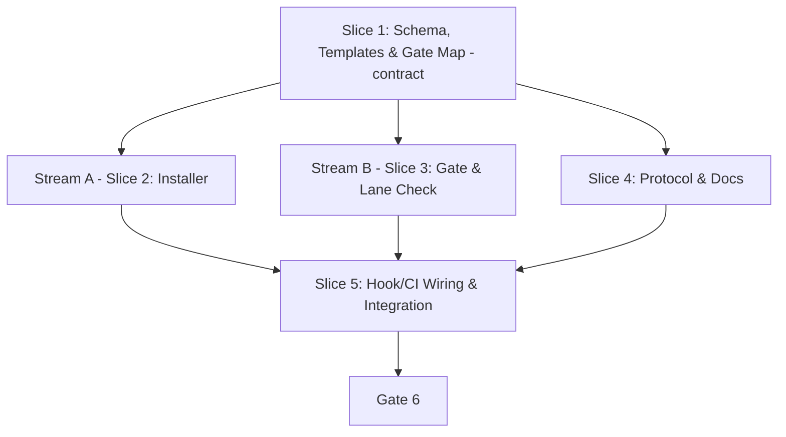

# Task Breakdown: SDTRD as an OpenSpec Addon

**Feature Branch**: `feat/w3.1-openspec-addon`

Scope note: this feature delivers REQ-OSA-1…19 and NFR-OSA-1…5. REQ-OSA-20 (self-migration of SDTRD's own repo, roadmap W3.8) is executed as a follow-on item after this feature ships, because this feature's own artifacts still live in the legacy `specs/features/` layout and are archived with the legacy Gate 6 steps.

## 1. Dependency DAG

Slice 1 is the contract lock (schema DAG and gate map consumed by installer and check) and MUST be committed before spawning worktrees. Slice 4 is documentation-only (no rails) and runs sequentially on the feature branch.

## 2. Multi-Agent Worktree Streams

| Stream | Worktree Path | Branch | Prerequisite |
| :--- | :--- | :--- | :--- |
| **Core** | *(Main feature worktree)* | `feat/w3.1-openspec-addon` | — |
| **Stream A: Installer** | `.worktrees/w3.1-installer` | `feat/w3.1/installer` | Slice 1 |
| **Stream B: Check** | `.worktrees/w3.1-check` | `feat/w3.1/check` | Slice 1 |

Shared-file protocol (Rule 3.7): both streams touch `Makefile`, `tests/bdd/test_bdd.sh` and `tests/` helpers; resolve conflicts additively. Stream A owns `bin/sdtrd`; Stream B owns the new `bin/sdtrd-check`.

---

## 3. Vertical Slice Execution Order

### Slice 1: Schema, Templates & Gate Map (REQ-OSA-1–6, 10; Scenario 4.5)
- [x] 1.1 **BDD (Step 5.1-A)**: Scenarios for schema resolution, `research` blocking `proposal`, templates ending in unticked Review Gate.
- [x] 1.2 **Review Gate 5.1**: Human sign-off on BDD scenarios.
- [x] 1.3 **Unit Tests (Red)**: Assert schema DAG/`apply` fields and every template's Review Gate footer; optional `openspec` integration check (`openspec schemas` lists `sdtrd`).
- [x] 1.4 **Implementation (Green)**: `schemas/sdtrd/schema.yaml` and `templates/`; gate map documented in the schema. Commit and lock contract.
- [x] 1.5 **Mutation (manual checklist, per Gate 3)**: Flip each DAG edge/footer expectation and confirm a test fails.

### Slice 2 [Stream A]: Installer (REQ-OSA-11–15; NFR-OSA-1, 2, 4; Scenarios 4.1–4.4) (`.worktrees/w3.1-installer`)
- [x] 2.1 **BDD (Step 5.2-A)**: Scenarios 4.1–4.4 and edge cases 1–3.
- [x] 2.2 **Review Gate 5.2**: Human sign-off on BDD scenarios.
- [x] 2.3 **Unit Tests (Red)**: `version_ge`, `set_schema_line`, prerequisite failures, idempotence, existing `.pre-commit-config.yaml`/hook preserved.
- [x] 2.4 **Implementation (Green)**: Rework `bin/sdtrd` to wire into `openspec/`; coverage ≥ 95% line/branch.
- [x] 2.5 **Mutation (manual checklist)**: Boundary flips (`1.14.9`/`1.15.0`/`1.15.1`, present/absent `schema:` line).

### Slice 3 [Stream B]: Gate & Lane Check (REQ-OSA-16–18; NFR-OSA-1, 3, 4; Scenarios 4.6–4.8) (`.worktrees/w3.1-check`)
- [x] 3.1 **BDD (Step 5.3-A)**: Scenarios 4.6–4.8 and edge cases 4–5.
- [x] 3.2 **Review Gate 5.3**: Human sign-off on BDD scenarios.
- [x] 3.3 **Unit Tests (Red)**: `gate_ticked`, `violations`, branch guard, empty changes, malformed JSON, multi-violation output, stub `openspec`.
- [x] 3.4 **Implementation (Green)**: `bin/sdtrd-check`; coverage ≥ 95% line/branch.
- [x] 3.5 **Mutation (manual checklist)**: Ticked/unticked, missing section, `main`/`master`, exit-code flips.

### Slice 4: Protocol & Docs (REQ-OSA-7–10, 15, 19; Scenario 4.9)
- [ ] 4.1 Update `specs/WORKFLOW.md`: delta-spec model, `openspec/` layout, Gate 6 via `openspec archive`, stream rebase + `openspec validate` rule, remove full-copy rule (migrated-project semantics; legacy layout noted for this repo until W3.8).
- [ ] 4.2 Update `rules/AGENTS.md`, `skills/sdtrd/SKILL.md`, `README.md`, `docs/` for the addon install flow, `jq` prerequisite and `REQ-*` header convention.
- [ ] 4.3 Chore-lane check: existing lint/unit/BDD suites unchanged and green.

### Slice 5: Hook/CI Wiring & Integration (REQ-OSA-12, 16, 17)
- [ ] 5.1 **BDD (Step 5.5-A)**: End-to-end scenario installing into a scratch `openspec init` project and running the check.
- [ ] 5.2 **Review Gate 5.5**: Human sign-off on BDD scenarios.
- [ ] 5.3 **Unit Tests (Red)** then **Implementation (Green)**: Extend hook and `templates/sdtrd-ci.yml` to call `sdtrd-check`; keep existing branch-protection and LGTM directive behavior.
- [ ] 5.4 **Mutation (manual checklist)** on hook wiring conditions.

---

## 4. Integration, Rebase & Gate 6 Checklist

- [x] Merge completed stream worktrees (rebase onto feature branch, re-verify, `git merge --ff-only`), remove worktrees, and prune (`git worktree prune`). Verify `git worktree list` shows only the repository root.
- [ ] Full test suite passes with ≥ 95% line and branch coverage.
- [ ] Full mutation checklist re-run on all pure functions (no tool for POSIX `sh`; deviation approved at Gate 3).
- [ ] Sync spec to `specs/living/openspec-addon/spec.md` and archive with the legacy Gate 6 steps (this feature predates the migration).
- [x] **Gate 4 Approval**: Tasks breakdown approved by human before writing test code.
- [ ] **Gate 6 Approval**: Final sync and archive sign-off.
